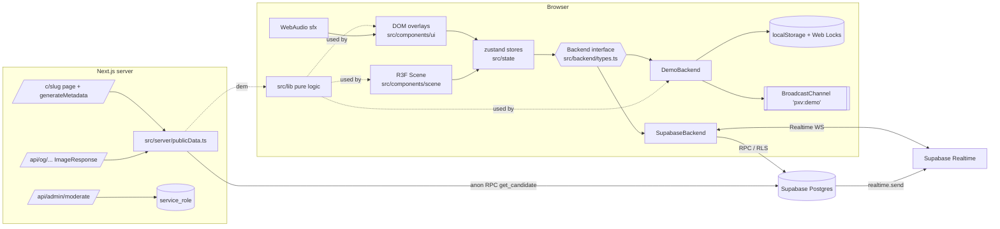

# Design: Phố Xin Việc 3D (MVP)

Requirements: `.squad/REQUIREMENTS.md` (v1.0, 2026-11-04). ADRs: `.squad/adr/0001..0004`.
Author: Software Architect. Status: Proposed (ready for one developer to build in one go).

> The repo is greenfield (only `README.md`). Everything below is new. Where this design deviates from
> REQUIREMENTS.md, it is called out in **§13 Conflicts with requirements** rather than silently changed.
> All business constants below come from REQUIREMENTS.md §5 (BR-*) — they override the illustrative numbers in the original brief
> (e.g. HR gets **10 xu/day, 2 per candidate/day**, not 3/100).

---

## 1. Overview

A single Next.js 16 (App Router, TypeScript, React 19) app. The 3D street is a client-only React Three Fiber
canvas; all panels (CV, forms, inbox, leaderboard, temple) are normal DOM overlays (accessibility + SEO).
All data access goes through one **`Backend` interface** with two implementations chosen at runtime:

- **`SupabaseBackend`** — when `NEXT_PUBLIC_SUPABASE_URL` + `NEXT_PUBLIC_SUPABASE_ANON_KEY` are set. Anonymous auth,
  all writes via Postgres `security definer` RPCs that enforce every limit, RLS on everything, Realtime
  *Broadcast from Database* (`realtime.send`) for street events + personal inbox, client Broadcast/Presence for walkers.
- **`DemoBackend`** — no env (or `NEXT_PUBLIC_FORCE_DEMO=1`). localStorage "database" + Web Locks for atomic writes,
  `BroadcastChannel` to make several tabs behave as several users (presence, ticker, notifications), seeded
  sample candidates and optional bots. It enforces the **same rules** by calling the pure `src/lib/` rule engine.

Pure, framework-agnostic logic (`src/lib/`: rules/limits config, validation, moderation, ranking, seats, layout,
fortune, hashing, time, notification aggregation) is unit-tested with Vitest and reused by DemoBackend, the UI and
the server (OG images). SQL mirrors the constants; a Vitest **parity test** reads the migration file and asserts the
SQL config JSON and blocklist equal the TS ones.



### Tech stack (pin to latest compatible at install time; verify with `pnpm view <pkg> version`)
`next@16`, `react@19`, `react-dom@19`, `three@0.18x` (+ `@types/three` matching), `@react-three/fiber@9`,
`@react-three/drei@10` (only `PerformanceMonitor`, `AdaptiveDpr`, `useDetectGPU` optional — **no drei `<Text>`**, see ADR-0003),
`zustand@5`, `@supabase/supabase-js@2`. Dev: `typescript`, `vitest`, `@playwright/test` (Chromium preinstalled — do **not** run `playwright install`), `eslint` + `eslint-config-next`.
No `@supabase/ssr` needed: auth is client-side anonymous; server only does anonymous public reads.

### Environment variables (`.env.example`)
| Var | Where | Purpose |
|---|---|---|
| `NEXT_PUBLIC_SUPABASE_URL`, `NEXT_PUBLIC_SUPABASE_ANON_KEY` | client+server | Enables SupabaseBackend. Missing → demo mode. |
| `NEXT_PUBLIC_FORCE_DEMO` | client+server | `1` forces demo even if Supabase vars exist. |
| `NEXT_PUBLIC_SITE_URL` | server | `metadataBase` for absolute OG URLs (default `http://localhost:3000`). |
| `NEXT_PUBLIC_DEMO_BOTS` | client | `0` disables demo bots (default on). |
| `SUPABASE_SERVICE_ROLE_KEY`, `ADMIN_KEY` | server only | `/api/admin/moderate` (BR-M6). Never `NEXT_PUBLIC_`. |

Mode detection lives in one function: `src/backend/mode.ts → getBackendMode(): 'supabase' | 'demo'` (used by client factory and server data helpers).

---

## 2. Folder structure (concrete file list)

```
package.json                     pnpm scripts: dev, build, start, lint, typecheck, test, test:e2e
next.config.ts                   security headers (CSP etc.), reactStrictMode
tsconfig.json                    strict, paths "@/*" -> "src/*"
vitest.config.ts                 environment node, include tests/**/*.test.ts
playwright.config.ts             chromium only, webServer: pnpm dev, baseURL :3000
eslint.config.mjs
.env.example
README.md                        how to run demo, how to connect Supabase, how to apply migration

supabase/
  migrations/0001_init.sql       §4 verbatim
  seed.sql                       OPTIONAL sample candidates for staging (is_sample=true)

src/app/
  layout.tsx                     fonts (next/font/google: Be_Vietnam_Pro UI, Patrick_Hand signs; subsets latin+vietnamese), metadataBase
  globals.css
  page.tsx                       server shell -> <StreetApp searchParams />   (reads ?c=slug, ?as=demoUser)
  not-found.tsx
  c/[slug]/page.tsx              public share landing (SSR, no JS needed for meta)
  q/[fortuneId]/page.tsx         fortune share landing
  api/og/c/[slug]/route.tsx      ImageResponse 1200x630 for a candidate sign
  api/og/q/[fortuneId]/route.tsx ImageResponse for a fortune
  api/admin/moderate/route.ts    POST {candidateId, action} with header x-admin-key; supabase only
  terms/page.tsx                 static terms/privacy (16+, virtual currency) — A8

src/backend/
  types.ts                       Backend interface, DTOs, ErrorCode, Result<T>   (§5)
  mode.ts                        getBackendMode()
  index.ts                       createBackend(): Backend (client-only singleton)
  topics.ts                      topic names: 'street', `pos:${zone}`, `inbox:${uid}`; event names
  supabase/client.ts             createClient (persistSession, autoRefreshToken)
  supabase/SupabaseBackend.ts
  supabase/mappers.ts            snake_case rows -> DTOs
  supabase/presence.ts           zone-sharded pose channels + global presence
  demo/DemoBackend.ts            implements Backend using engine.ts
  demo/engine.ts                 "stored procedures" in TS: same check order & error codes as SQL
  demo/db.ts                     DemoDb schema, load/save/migrate, KeyValueStore + Locks abstractions
  demo/bus.ts                    Bus abstraction over BroadcastChannel (+ MemoryBus for tests)
  demo/identity.ts               per-tab identity claim (sessionStorage + Web Locks), ?as= override
  demo/presence.ts               heartbeats, peer expiry 15 s
  demo/bots.ts                   leader-elected bot walkers/givers
  demo/seed.ts                   seeds DemoDb from src/lib/seed.ts

src/lib/                         PURE: no React, no three, no DOM, no Date.now() inside (time passed in)
  rules.ts                       LIMITS (mirrors SQL cfg), RANK weights, ZONE ids, TZ
  zones.ts                       zone metadata (id, name, color, props)
  layout.ts                      street dimensions, zoneStartZ, seatTransform, bounds, plaza colliders
  time.ts                        vnDay(ms) 'YYYY-MM-DD', dayDiff, startOfIsoWeekVn
  hash.ts                        fnv1a32, mix32, mulberry32, hashString
  validation/candidate.ts        validateCandidateInput -> {ok,value}|{ok:false,errors}
  validation/profile.ts          validateProfileInput
  validation/contact.ts          email/url/phone validators, toSafeHref
  moderation/normalize.ts        clean(), exactForm(), looseForm(), compactForm()
  moderation/blocklist.ts        isBlocked(text) using config below
  moderation/pii.ts              hasPii(text): url/email/phone detection (BR-M4)
  limits.ts                      pure checkers used by demo engine: checkGift, checkInvite, checkOffer, ...
  ranking.ts                     decay, decayedSums, profileCompleteness, rankingScore, compareCandidates
  seats.ts                       assignSeats, appendNewcomer, rankInZone
  fortune.ts                     FORTUNES (>=40), drawFortuneDemo, selectFortune
  signTemplates.ts               >=20 templates + fillTemplate
  notify.ts                      NotificationAggregator (AC-13.5), effectiveStatus (lazy expiry)
  events.ts                      formatTickerLine(event) -> string (plain text)
  seed.ts                        deterministic sample candidates (used by demo + server OG in demo)
  messages.ts                    ErrorCode -> Vietnamese humorous copy
  shareCodec.ts                  encode/decode demo share payload (?d=) with validation

src/config/
  blocklist.vi.ts                DATA ONLY: export const BLOCKLIST = String.raw`...one term per line...` (BR-M3)
  allowlist.vi.ts                DATA ONLY

src/state/
  session.ts                     zustand: me, quota, mode
  world.ts                       zustand: candidates Map, seatPlan, peers, tickerLines, templeToday
  ui.ts                          zustand: open panel, selected candidate, toasts, muted, view2d
  input.ts                       NON-reactive mutable object for movement input (read in useFrame)

src/hooks/
  useBackend.ts  useKeyboard.ts  useIsMobile.ts  useStreetSync.ts (load+subscribe+60 s seat tick)
  useInbox.ts  usePresenceSync.ts  useReducedMotion.ts  useWebGLSupport.ts

src/audio/sfx.ts                 WebAudio synthesized sounds (§9)

src/scene-lib/                   three-dependent helpers (not React)
  geometry/street.ts             merged static street geometry (vertex colors)
  geometry/avatar.ts             body/head/hat/bowl/sign geometries (sitting + standing)
  geometry/props.ts              temple, bridge, gate, lamp
  signTexture.ts                 drawSign(canvas, text, opts) — wrap 2 lines, autoshrink
  labelTexture.ts                name labels, zone gate labels
  textureCache.ts                LRU<CanvasTexture> with dispose()
  picking.ts                     rayToGround, pickCandidate(ray, seats) (no mesh raycast)
  interpolation.ts               SnapshotBuffer for remote poses

src/components/
  app/StreetApp.tsx              'use client'; BackendProvider, boot, dynamic(() => import('../scene/Scene'), {ssr:false})
  app/BackendProvider.tsx
  scene/Scene.tsx                <Canvas> config, PerformanceMonitor, fog, lights
  scene/StreetStatic.tsx
  scene/ZoneGates.tsx
  scene/Plaza.tsx                head-of-street plaza: Temple + WallOfFame + Top10 billboard
  scene/Temple.tsx
  scene/WallOfFame.tsx
  scene/CandidateInstances.tsx   per-zone instanced chunks
  scene/NearbySigns.tsx
  scene/Player.tsx
  scene/FollowCamera.tsx
  scene/RemoteWalkers.tsx
  scene/GiftEffects.tsx          coins, banknotes, hearts, confetti (pooled instancing)
  scene/Reactions3D.tsx          emoji atlas instanced quads
  scene/PointerController.tsx    tap/click -> pickCandidate or move target
  ui/Onboarding.tsx              name + role (+company for HR), consent checkbox, honeypot
  ui/Hud.tsx                     online count, quota, zone menu (teleport), mute, 2D toggle, inbox badge
  ui/CandidatePanel.tsx          CV panel (AC-8.*), action buttons with disabled reasons
  ui/CandidateForm.tsx           create/edit form, live sign preview (same signTexture canvas), "Gợi ý"
  ui/InviteForm.tsx  ui/OfferForm.tsx
  ui/Inbox.tsx                   notifications + invitations/offers with Accept/Decline
  ui/Ticker.tsx  ui/Toasts.tsx  ui/Leaderboard.tsx (Đầu phố top10, Top xu tuần)
  ui/TemplePanel.tsx  ui/FortuneCard.tsx
  ui/ReactionBar.tsx  ui/Joystick.tsx  ui/ListView2D.tsx (fallback, AC edge case)
  ui/ShareSheet.tsx              copy link, Web Share API, download PNG (fetch OG route)
  ui/DemoBanner.tsx              "Bản demo — dữ liệu chỉ nằm trong trình duyệt này"

src/server/
  publicData.ts                  'server-only': getPublicCandidate(slug, d?), getPublicFortune(id)
  ogFonts.ts                     load TTF for satori (local file -> Google Fonts -> none)
src/assets/fonts/                PatrickHand-Regular.ttf, BeVietnamPro-Bold.ttf + OFL.txt (download once; see §10)

tests/
  lib/ranking.test.ts  lib/seats.test.ts  lib/limits.test.ts  lib/fortune.test.ts
  lib/moderation.test.ts  lib/validation.test.ts  lib/time.test.ts  lib/notify.test.ts
  lib/signTemplates.test.ts  lib/shareCodec.test.ts
  parity/sql-config.test.ts      SQL cfg JSON == LIMITS; SQL blocklist == BLOCKLIST
  backend/demo.test.ts           two DemoBackend instances on MemoryBus/MemoryStore
e2e/smoke.spec.ts                demo mode: onboarding, 2D list, drop xu, second page receives toast
```

---

## 3. Domain constants (single source: `src/lib/rules.ts`, mirrored in SQL `private.cfg()`)

```ts
export const TZ = 'Asia/Ho_Chi_Minh';
export const ZONE_IDS = ['backend','frontend','design','mobile','data_ai','qa','pm_ba','devops','fresher','other'] as const;
export type ZoneId = typeof ZONE_IDS[number];

export const LIMITS = {
  zones: ZONE_IDS,
  xu:     { perDay: 10, perCandidatePerDay: 2 },                       // BR-C1, BR-C2
  love:   { perDay: 5,  perCandidatePerDay: 1, perIpPerDay: 30 },       // BR-L1, BR-L3
  invite: { perDay: 3, cooldownDays: 7, maxOpenPerCandidate: 5, expireDays: 14,
            messageMin: 10, messageMax: 200, contactMin: 3, contactMax: 120 },   // BR-5-*
  offer:  { maxOpenPerHr: 3, expireDays: 7, positionMax: 60, packageMax: 100, messageMax: 300 }, // BR-O*
  giftOpsPerSecond: 5,            // BR-SP1
  profileCreatePer10Min: 1,       // BR-SP1
  signEditsPerHour: 10,           // BR-SP1
  zoneChangeHours: 24,            // BR-S4
  nameChangeHours: 24,            // §7.1
  hrSignupsPerIpPerHour: 3,       // BR-SP3
  reportsToHideSign: 3,           // US-20
  reportsPerDay: 20,
  seatsPerZone: 30,               // BR-Rank
  rank: { halfLifeDays: 7, windowDays: 60, loveDailyCap: 20 },  // used by SQL decayed sums
} as const;
```
The literal JSON of `LIMITS` (via `JSON.stringify`) must deep-equal the JSON between the `BEGIN:LIMITS_JSON` /
`END:LIMITS_JSON` markers in the migration (`tests/parity/sql-config.test.ts`).

Day = calendar day in `Asia/Ho_Chi_Minh` (UTC+7, no DST). `vnDay(ms) = new Date(ms + 7*3600_000).toISOString().slice(0,10)`.
Server time is the only authority in Supabase mode (RPCs use `now()`); clients never send timestamps.

---

## 4. Data model — `supabase/migrations/0001_init.sql`

Design choices:
- **No direct table writes from clients.** Every write is a `security definer` RPC with `set search_path = ''`, returning
  `jsonb` `{ok:true,data}` or `{ok:false,error,field?,retryAfterSec?}` (easy to map; no exception parsing).
- **Reads**: candidates are read only through RPCs (`list_candidates`, `get_candidate`) so hidden fields (user_id,
  contact, pending signs) can never leak through PostgREST column selection. Parties read their own
  `invitations`/`offers`/`notifications`/`profiles` through RLS.
- **Counters**: `candidate_daily` buckets (one row per candidate per VN day) make decayed ranking sums cheap
  (≤ 60 rows/candidate) and give "today"/"this week" numbers.
- **Lazy expiry** of invitations (14 d) and offers (7 d): RPCs flip stale `pending` rows to `expired` before checks;
  clients display `effectiveStatus()` (`lib/notify.ts`). No cron needed.
- **Rate limits** via a generic fixed-window counter `private.rate_hits` (also IP-hash keys, ≤ 2 days retention, NFR privacy).
- Advisory lock per actor (`pg_advisory_xact_lock`) serializes concurrent requests from the same user so
  "20 parallel requests deduct quota exactly" (BR-C5) holds.

```sql
-- =====================================================================
-- supabase/migrations/0001_init.sql — Phố Xin Việc 3D (initial schema)
-- =====================================================================
create extension if not exists unaccent with schema extensions;
create extension if not exists pgcrypto with schema extensions;

create schema if not exists private;
revoke all on schema private from public;
-- private.* is never exposed through the Data API and anon/authenticated get no USAGE on it.

-- ---------- Config: MUST mirror src/lib/rules.ts LIMITS (parity test) ----------
create or replace function private.cfg() returns jsonb
language sql immutable as $fn$
select
-- BEGIN:LIMITS_JSON
'{"zones":["backend","frontend","design","mobile","data_ai","qa","pm_ba","devops","fresher","other"],
  "xu":{"perDay":10,"perCandidatePerDay":2},
  "love":{"perDay":5,"perCandidatePerDay":1,"perIpPerDay":30},
  "invite":{"perDay":3,"cooldownDays":7,"maxOpenPerCandidate":5,"expireDays":14,"messageMin":10,"messageMax":200,"contactMin":3,"contactMax":120},
  "offer":{"maxOpenPerHr":3,"expireDays":7,"positionMax":60,"packageMax":100,"messageMax":300},
  "giftOpsPerSecond":5,"profileCreatePer10Min":1,"signEditsPerHour":10,"zoneChangeHours":24,"nameChangeHours":24,
  "hrSignupsPerIpPerHour":3,"reportsToHideSign":3,"reportsPerDay":20,"seatsPerZone":30,
  "rank":{"halfLifeDays":7,"windowDays":60,"loveDailyCap":20}}'
-- END:LIMITS_JSON
::jsonb
$fn$;

-- ---------- Secrets ----------
create table private.secrets (name text primary key, value text not null);
insert into private.secrets(name, value) values
  ('fortune_salt', encode(extensions.gen_random_bytes(16), 'hex')),
  ('ip_salt',      encode(extensions.gen_random_bytes(16), 'hex'));

-- ---------- Helpers ----------
create or replace function private.vn_today() returns date
language sql stable as $$ select (now() at time zone 'Asia/Ho_Chi_Minh')::date $$;

create or replace function private.ok(p_data jsonb default '{}'::jsonb) returns jsonb
language sql immutable as $$ select jsonb_build_object('ok', true, 'data', p_data) $$;

create or replace function private.err(p_code text, p_field text default null, p_retry int default null) returns jsonb
language sql immutable as $$
  select jsonb_strip_nulls(jsonb_build_object('ok', false, 'error', p_code, 'field', p_field, 'retryAfterSec', p_retry))
$$;

-- NFKC + strip control / zero-width / bidi-override chars, collapse spaces, trim. Mirrors lib/moderation/normalize.ts clean()
create or replace function private.clean(p text) returns text
language sql immutable as $$
  select nullif(btrim(regexp_replace(regexp_replace(
           normalize(coalesce(p, ''), NFKC),
           '[\u0000-\u0009\u000B-\u001F\u007F­​-‏‪-‮⁠-⁤⁦-⁩]', '', 'g'),
         '[ \t]+', ' ', 'g')), '')
$$;

-- ---------- Moderation (mirrors lib/moderation/*) ----------
-- mode: 'exact'   = token match on lowercased NFKC text WITH diacritics (e.g. 'lồn' so that 'lon'/'lớn' are not hit)
--       'loose'   = token match on unaccented + leet-mapped + single-letter-joined text (e.g. 'dm', 'vcl', 'dit me')
--       'compact' = substring match on loose text with spaces removed (only for long, distinctive terms, >= 5 chars)
create table private.blocklist (term text primary key, mode text not null check (mode in ('exact','loose','compact')));
create table private.allowlist (phrase text primary key);   -- loose-form phrases removed before matching

-- BEGIN:BLOCKLIST_SQL  (generated by hand from src/config/blocklist.vi.ts; parity test compares the sets)
insert into private.blocklist(term, mode) values
  ('dm','loose'), ('dcm','loose'), ('dmm','loose'), ('vcl','loose'), ('vkl','loose'), ('vl','loose'),
  ('cmm','loose'), ('clm','loose'), ('dit','loose'), ('dit me','loose'), ('du ma','loose'), ('cho chet','loose'),
  ('lồn','exact'), ('buồi','exact'), ('cặc','exact'), ('đĩ','exact'), ('đéo','exact'), ('địt','exact'),
  ('ngu như chó','exact'), ('đa cấp','exact'),
  ('ditconme','compact'), ('dumamay','compact'), ('chuyenkhoan','compact'), ('stk ngan hang','loose'),
  ('casino','loose'), ('nhacai','compact'), ('kiemtienonline','compact')
on conflict do nothing;
-- END:BLOCKLIST_SQL

create or replace function private.loose(p text) returns text
language sql stable as $$
  select regexp_replace(                                           -- join spaced single letters: "d m" -> "dm"
           btrim(regexp_replace(
             translate(extensions.unaccent('extensions.unaccent'::regdictionary, lower(normalize(coalesce(p,''), NFKC))),
                       '013457@$', 'oieastas'),
             '[^a-z0-9]+', ' ', 'g')),
           '\m([a-z0-9]) (?=[a-z0-9]\M)', '\1', 'g')
$$;

create or replace function private.is_blocked(p text) returns boolean
language plpgsql stable as $$
declare
  v_exact   text := ' ' || btrim(regexp_replace(lower(normalize(coalesce(p,''), NFKC)), '[^[:alnum:]]+', ' ', 'g')) || ' ';
  v_loose   text := ' ' || private.loose(p) || ' ';
  v_compact text;
  a record;
begin
  for a in select phrase from private.allowlist loop
    v_loose := replace(v_loose, ' ' || a.phrase || ' ', ' ');
  end loop;
  v_compact := replace(v_loose, ' ', '');
  return exists (
    select 1 from private.blocklist b where
      (b.mode = 'exact'   and position(' ' || b.term || ' ' in v_exact) > 0) or
      (b.mode = 'loose'   and position(' ' || b.term || ' ' in v_loose) > 0) or
      (b.mode = 'compact' and position(b.term in v_compact) > 0));
end $$;

-- BR-M4: no URL / email / phone in sign, bio, title
create or replace function private.has_pii(p text) returns boolean
language sql immutable as $$
  select coalesce(p, '') ~* '(https?://|www\.|[a-z0-9-]+\.(com|vn|net|io|me|org|dev)\M)'
      or coalesce(p, '') ~* '[^@\s]+@[^@\s]+\.[a-z]{2,}'
      or regexp_replace(coalesce(p, ''), '[\s.\-()]', '', 'g') ~ '(\+?84|0)[0-9]{8,10}'
$$;

-- ---------- Rate limiting (fixed window) ----------
create table private.rate_hits (key text not null, bucket timestamptz not null, n int not null default 0,
                                primary key (key, bucket));

create or replace function private.hit(p_key text, p_window interval, p_max int) returns boolean
language plpgsql as $$
declare
  v_secs double precision := extract(epoch from p_window);
  v_bucket timestamptz := to_timestamp(floor(extract(epoch from now()) / v_secs) * v_secs);
  v_n int;
begin
  insert into private.rate_hits(key, bucket, n) values (p_key, v_bucket, 1)
  on conflict (key, bucket) do update set n = private.rate_hits.n + 1
  returning n into v_n;
  if random() < 0.01 then delete from private.rate_hits where bucket < now() - interval '2 days'; end if;
  return v_n <= p_max;
end $$;

-- Hashed client IP from PostgREST request headers (null if unavailable -> IP limits fail open)
create or replace function private.client_ip_hash() returns text
language sql stable as $$
  select case when ip is null then null
         else encode(extensions.digest(ip || (select value from private.secrets where name = 'ip_salt'), 'sha256'), 'hex') end
  from (select nullif(btrim(split_part(coalesce(
          current_setting('request.headers', true)::json ->> 'x-forwarded-for', ''), ',', 1)), '') as ip) s
$$;

-- ---------- Types ----------
create type public.user_role        as enum ('hr', 'candidate', 'viewer');
create type public.candidate_status as enum ('sitting', 'hidden', 'placed');
create type public.sign_state       as enum ('ok', 'pending_review', 'removed');
create type public.gift_kind        as enum ('xu', 'love');
create type public.invite_status    as enum ('pending', 'accepted', 'declined', 'expired', 'closed');
create type public.offer_status     as enum ('pending', 'accepted', 'declined', 'expired', 'closed');
create type public.contact_kind     as enum ('email', 'url', 'phone');

-- ---------- Tables ----------
create table public.profiles (
  id              uuid primary key references auth.users(id) on delete cascade,
  display_name    text not null check (char_length(display_name) between 2 and 24),
  role            public.user_role not null,
  company         text check (company is null or char_length(company) between 2 and 40),
  avatar          jsonb not null default '{}'::jsonb check (pg_column_size(avatar) < 1024),
  name_changed_at timestamptz,
  created_at      timestamptz not null default now(),
  updated_at      timestamptz not null default now(),
  constraint hr_needs_company check (role <> 'hr' or company is not null)
);

create table public.candidates (
  id                  uuid primary key default gen_random_uuid(),
  user_id             uuid unique references public.profiles(id) on delete cascade,   -- null only for sample rows
  slug                text not null unique default substr(replace(gen_random_uuid()::text, '-', ''), 1, 10),
  is_sample           boolean not null default false,
  display_name        text not null,
  zone                text not null check (zone in ('backend','frontend','design','mobile','data_ai','qa','pm_ba','devops','fresher','other')),
  sign_text           text not null check (char_length(sign_text) between 5 and 80),
  title               text not null check (char_length(title) between 1 and 60),
  years_exp           smallint not null check (years_exp between 0 and 50),
  skills              text[] not null check (cardinality(skills) between 1 and 10),
  salary_min          int check (salary_min between 0 and 1000),          -- triệu VND / tháng
  salary_max          int check (salary_max between 0 and 1000),
  salary_negotiable   boolean not null default false,
  city                text check (char_length(city) <= 40),
  work_modes          text[] not null default '{}' check (work_modes <@ array['remote','hybrid','onsite']::text[]),
  bio                 text check (char_length(bio) <= 280),
  avatar              jsonb not null default '{}'::jsonb check (pg_column_size(avatar) < 1024),
  status              public.candidate_status not null default 'sitting',
  sign_state          public.sign_state not null default 'ok',
  hide_from_ticker    boolean not null default false,
  show_salary_on_card boolean not null default false,
  sitting_since       timestamptz not null default now(),
  zone_changed_at     timestamptz,
  placed_at           timestamptz,
  placed_company      text,                    -- only set when BOTH sides consented (BR-O4)
  xu_total            int not null default 0,
  love_total          int not null default 0,
  invite_total        int not null default 0,
  incense_total       int not null default 0,
  report_count        int not null default 0,
  created_at          timestamptz not null default now(),
  updated_at          timestamptz not null default now(),
  constraint salary_range check (salary_min is null or salary_max is null or salary_min <= salary_max)
);
create index candidates_status_zone_idx on public.candidates (status, zone);

create table public.candidate_contacts (       -- BR-Privacy: separate table, readable only via RPC
  candidate_id uuid primary key references public.candidates(id) on delete cascade,
  kind         public.contact_kind not null,
  value        text not null check (char_length(value) between 3 and 120)
);

create table public.gifts (                     -- audit log of xu / love (BR-C5)
  id           bigint generated always as identity primary key,
  giver_id     uuid not null references public.profiles(id) on delete cascade,
  candidate_id uuid not null references public.candidates(id) on delete cascade,
  kind         public.gift_kind not null,
  day          date not null,
  created_at   timestamptz not null default now()
);
create index gifts_giver_day_idx      on public.gifts (giver_id, day, kind);
create index gifts_pair_day_idx       on public.gifts (giver_id, candidate_id, day, kind);
create index gifts_candidate_time_idx on public.gifts (candidate_id, created_at desc);

create table public.candidate_daily (
  candidate_id     uuid not null references public.candidates(id) on delete cascade,
  day              date not null,
  xu               int not null default 0,
  love             int not null default 0,
  invites          int not null default 0,
  invites_accepted int not null default 0,
  primary key (candidate_id, day)
);

create table public.invitations (               -- "tờ 500k"
  id              uuid primary key default gen_random_uuid(),
  hr_id           uuid not null references public.profiles(id) on delete cascade,
  candidate_id    uuid not null references public.candidates(id) on delete cascade,
  hr_name         text not null,                -- snapshots (candidate cannot read HR profile via RLS)
  hr_company      text not null,
  message         text not null check (char_length(message) between 10 and 200),
  hr_contact      text not null check (char_length(hr_contact) between 3 and 120),
  status          public.invite_status not null default 'pending',
  response_reason text check (char_length(response_reason) <= 200),
  day             date not null,
  created_at      timestamptz not null default now(),
  responded_at    timestamptz,
  expires_at      timestamptz not null default now() + interval '14 days'
);
create unique index invitations_open_pair_uq on public.invitations (hr_id, candidate_id) where status = 'pending';
create index invitations_candidate_idx on public.invitations (candidate_id, status);
create index invitations_hr_idx        on public.invitations (hr_id, created_at desc);

create table public.offers (                    -- "bao trọn"
  id                     uuid primary key default gen_random_uuid(),
  hr_id                  uuid not null references public.profiles(id) on delete cascade,
  candidate_id           uuid not null references public.candidates(id) on delete cascade,
  invitation_id          uuid not null references public.invitations(id) on delete cascade,
  hr_name                text not null,
  hr_company             text not null,
  position               text not null check (char_length(position) between 1 and 60),
  package                text not null check (char_length(package) between 1 and 100),
  message                text check (char_length(message) <= 300),
  hr_show_company        boolean not null default false,
  candidate_show_company boolean,
  status                 public.offer_status not null default 'pending',
  response_reason        text check (char_length(response_reason) <= 200),
  created_at             timestamptz not null default now(),
  responded_at           timestamptz,
  expires_at             timestamptz not null default now() + interval '7 days'
);
create unique index offers_open_candidate_uq on public.offers (candidate_id) where status = 'pending';  -- BR-O2
create index offers_hr_idx on public.offers (hr_id, status);

create table public.incense (
  user_id             uuid not null references public.profiles(id) on delete cascade,
  day                 date not null,
  target_candidate_id uuid references public.candidates(id) on delete set null,
  created_at          timestamptz not null default now(),
  primary key (user_id, day)                    -- 1 per user per day
);
create index incense_day_idx on public.incense (day);

create table public.notifications (            -- persisted inbox (AC-13.3)
  id         bigint generated always as identity primary key,
  user_id    uuid not null references public.profiles(id) on delete cascade,
  type       text not null,   -- gift | invite_received | invite_responded | invite_closed | offer_received | offer_responded | incense_for_you | sign_hidden
  payload    jsonb not null default '{}'::jsonb,
  read_at    timestamptz,
  created_at timestamptz not null default now()
);
create index notifications_user_idx on public.notifications (user_id, created_at desc);

create table public.reports (
  id           bigint generated always as identity primary key,
  reporter_id  uuid not null references public.profiles(id) on delete cascade,
  candidate_id uuid not null references public.candidates(id) on delete cascade,
  reason       text not null check (reason in ('obscene','harassment','spam','personal_info','other')),
  note         text check (char_length(note) <= 200),
  created_at   timestamptz not null default now(),
  unique (reporter_id, candidate_id)            -- AC-20.1
);

-- ---------- RLS ----------
alter table public.profiles           enable row level security;
alter table public.candidates         enable row level security;   -- no policies: RPC-only access
alter table public.candidate_contacts enable row level security;   -- no policies: RPC-only access
alter table public.gifts              enable row level security;   -- no policies
alter table public.candidate_daily    enable row level security;   -- no policies
alter table public.invitations        enable row level security;
alter table public.offers             enable row level security;
alter table public.incense            enable row level security;   -- no policies
alter table public.notifications      enable row level security;
alter table public.reports            enable row level security;   -- no policies
alter table private.secrets enable row level security;
alter table private.rate_hits enable row level security;
alter table private.blocklist enable row level security;
alter table private.allowlist enable row level security;

-- helper usable inside policies (policies run as the invoker, who cannot read candidates)
create or replace function public.my_candidate_id() returns uuid
language sql stable security definer set search_path = '' as $$
  select id from public.candidates where user_id = auth.uid()
$$;

create policy profiles_select_own on public.profiles for select to authenticated
  using (id = (select auth.uid()));
create policy invitations_select_party on public.invitations for select to authenticated
  using (hr_id = (select auth.uid()) or candidate_id = (select public.my_candidate_id()));
create policy offers_select_party on public.offers for select to authenticated
  using (hr_id = (select auth.uid()) or candidate_id = (select public.my_candidate_id()));
create policy notifications_select_own on public.notifications for select to authenticated
  using (user_id = (select auth.uid()));

-- ---------- Realtime authorization (private channels) ----------
-- Topics: 'street' (DB-originated events + global presence), 'pos:<zone>' (client poses/reactions), 'inbox:<uid>'
create policy rt_read on realtime.messages for select to authenticated using (
  (select realtime.topic()) = 'street'
  or (select realtime.topic()) like 'pos:%'
  or (select realtime.topic()) = 'inbox:' || (select auth.uid())::text
);
create policy rt_write on realtime.messages for insert to authenticated with check (
  ((select realtime.topic()) like 'pos:%' and realtime.messages.extension in ('broadcast', 'presence'))
  or ((select realtime.topic()) = 'street' and realtime.messages.extension = 'presence')
  -- clients can NEVER broadcast on 'street' or 'inbox:*' => ticker/notifications cannot be spoofed
);

-- ---------- Realtime emit helpers ----------
create or replace function private.street(p_event text, p_payload jsonb) returns void
language plpgsql security definer set search_path = '' as $$
begin
  perform realtime.send(p_payload || jsonb_build_object('type', p_event, 'at', now()), p_event, 'street', true);
end $$;

create or replace function private.notify(p_user uuid, p_type text, p_payload jsonb) returns void
language plpgsql security definer set search_path = '' as $$
declare v_id bigint; v_at timestamptz;
begin
  if p_user is null then return; end if;                -- sample candidates have no user
  insert into public.notifications(user_id, type, payload) values (p_user, p_type, p_payload)
  returning id, created_at into v_id, v_at;
  perform realtime.send(jsonb_build_object('id', v_id::text, 'type', p_type, 'payload', p_payload, 'createdAt', v_at),
                        'notification', 'inbox:' || p_user::text, true);
end $$;

create or replace function private.ticker_name(c public.candidates) returns text
language sql immutable as $$ select case when c.hide_from_ticker then 'một bạn ẩn danh' else c.display_name end $$;

create or replace function private.completeness(c public.candidates) returns smallint   -- mirrors lib/ranking.ts
language sql immutable as $$
  select ((c.salary_min is not null or c.salary_max is not null or c.salary_negotiable)::int
        + (c.bio is not null)::int + (c.city is not null)::int
        + (cardinality(c.work_modes) > 0)::int + (cardinality(c.skills) >= 3)::int)::smallint
$$;

-- light card (same shape as list_candidates minus stats) used in 'candidate_upsert' broadcasts
create or replace function private.card_json(c public.candidates) returns jsonb
language sql stable as $$
  select jsonb_build_object(
    'id', c.id, 'slug', c.slug, 'display_name', c.display_name, 'zone', c.zone,
    'sign_text', case when c.sign_state = 'ok' then c.sign_text end, 'sign_state', c.sign_state,
    'title', c.title, 'years_exp', c.years_exp, 'skills', to_jsonb(c.skills), 'status', c.status,
    'is_sample', c.is_sample, 'avatar', c.avatar, 'sitting_since', c.sitting_since, 'created_at', c.created_at,
    'placed_at', c.placed_at, 'placed_company', c.placed_company,
    'xu_total', c.xu_total, 'love_total', c.love_total, 'invite_total', c.invite_total,
    'incense_total', c.incense_total, 'completeness', private.completeness(c))
$$;

create or replace function private.expire_stale(p_candidate uuid, p_hr uuid) returns void
language sql as $$
  update public.invitations set status = 'expired'
   where status = 'pending' and expires_at < now() and (candidate_id = p_candidate or hr_id = p_hr);
  update public.offers set status = 'expired'
   where status = 'pending' and expires_at < now() and (candidate_id = p_candidate or hr_id = p_hr);
$$;

create or replace function private.bump_daily(p_candidate uuid, p_col text) returns void
language plpgsql as $$
begin
  insert into public.candidate_daily(candidate_id, day) values (p_candidate, private.vn_today())
  on conflict (candidate_id, day) do nothing;
  execute format('update public.candidate_daily set %I = %I + 1 where candidate_id = $1 and day = $2', p_col, p_col)
  using p_candidate, private.vn_today();
end $$;

-- =====================================================================
-- RPCs (public schema, callable via supabase.rpc)
-- =====================================================================

-- ----- Profile / identity (US-1) -----
create or replace function public.upsert_profile(p_display_name text, p_role public.user_role,
                                                 p_company text default null, p_avatar jsonb default '{}'::jsonb)
returns jsonb language plpgsql security definer set search_path = '' as $$
declare
  v_uid uuid := auth.uid(); v_cfg jsonb := private.cfg();
  v_name text := private.clean(p_display_name);
  v_company text := private.clean(p_company);
  v_old public.profiles%rowtype; v_new public.profiles%rowtype; v_ip text; v_cand public.candidates%rowtype;
begin
  if v_uid is null then return private.err('UNAUTHENTICATED'); end if;
  if v_name is null or char_length(v_name) not between 2 and 24 then return private.err('VALIDATION', 'display_name'); end if;
  if private.is_blocked(v_name) then return private.err('BLOCKED_CONTENT', 'display_name'); end if;
  if p_role = 'hr' then
    if v_company is null or char_length(v_company) not between 2 and 40 then return private.err('VALIDATION', 'company'); end if;
    if private.is_blocked(v_company) then return private.err('BLOCKED_CONTENT', 'company'); end if;
  else v_company := null; end if;
  if p_avatar is null or pg_column_size(p_avatar) >= 1024 then return private.err('VALIDATION', 'avatar'); end if;

  select * into v_old from public.profiles where id = v_uid for update;
  if found and v_old.display_name <> v_name and v_old.name_changed_at is not null
     and v_old.name_changed_at > now() - make_interval(hours => (v_cfg->>'nameChangeHours')::int) then
    return private.err('NAME_CHANGE_COOLDOWN', 'display_name');
  end if;
  if p_role = 'hr' and (v_old.id is null or v_old.role <> 'hr') then           -- BR-SP3
    v_ip := private.client_ip_hash();
    if v_ip is not null and not private.hit('hr_ip:' || v_ip, interval '1 hour', (v_cfg->>'hrSignupsPerIpPerHour')::int) then
      return private.err('IP_LIMIT');
    end if;
  end if;

  insert into public.profiles(id, display_name, role, company, avatar)
  values (v_uid, v_name, p_role, v_company, p_avatar)
  on conflict (id) do update set
    display_name = excluded.display_name, role = excluded.role, company = excluded.company, avatar = excluded.avatar,
    name_changed_at = case when public.profiles.display_name <> excluded.display_name then now() else public.profiles.name_changed_at end,
    updated_at = now()
  returning * into v_new;

  update public.candidates set display_name = v_name, avatar = p_avatar, updated_at = now()
   where user_id = v_uid returning * into v_cand;
  if v_cand.id is not null and v_new.role <> 'candidate' and v_cand.status = 'sitting' then  -- A3: role switch hides profile
    update public.candidates set status = 'hidden' where id = v_cand.id;
    perform private.street('candidate_remove', jsonb_build_object('id', v_cand.id));
  elsif v_cand.id is not null and v_cand.status = 'sitting' then
    perform private.street('candidate_upsert', jsonb_build_object('candidate', private.card_json(v_cand)));
  end if;
  return private.ok(to_jsonb(v_new));
end $$;

-- ----- Candidate profile (US-2, US-4) -----
-- p: {sign_text,title,years_exp,skills[],salary_min,salary_max,salary_negotiable,city,work_modes[],bio,
--     hide_from_ticker,show_salary_on_card,zone,contact_kind,contact_value}
create or replace function public.upsert_my_candidate(p jsonb) returns jsonb
language plpgsql security definer set search_path = '' as $$
declare
  v_uid uuid := auth.uid(); v_cfg jsonb := private.cfg();
  v_prof public.profiles%rowtype; v_old public.candidates%rowtype; v_new public.candidates%rowtype;
  v_sign text := private.clean(p->>'sign_text');
  v_title text := private.clean(p->>'title');
  v_bio text := private.clean(p->>'bio');
  v_city text := private.clean(p->>'city');
  v_zone text := p->>'zone';
  v_ckind text := p->>'contact_kind';
  v_cval text := private.clean(p->>'contact_value');
  v_years int; v_smin int; v_smax int; v_skills text[]; v_modes text[];
begin
  if v_uid is null then return private.err('UNAUTHENTICATED'); end if;
  select * into v_prof from public.profiles where id = v_uid;
  if not found then return private.err('NO_PROFILE'); end if;
  if v_prof.role <> 'candidate' then return private.err('WRONG_ROLE'); end if;
  perform pg_advisory_xact_lock(hashtextextended('cand:' || v_uid::text, 0));

  -- validation: same order/fields as lib/validation/candidate.ts
  if v_sign is null or char_length(v_sign) not between 5 and 80
     or char_length(v_sign) - char_length(replace(v_sign, E'\n', '')) > 1 then return private.err('VALIDATION', 'sign_text'); end if;
  if v_zone is null or not (v_cfg->'zones') ? v_zone then return private.err('VALIDATION', 'zone'); end if;
  if v_title is null or char_length(v_title) > 60 then return private.err('VALIDATION', 'title'); end if;
  begin
    v_years := (p->>'years_exp')::int;
    v_smin := nullif(p->>'salary_min', '')::int;
    v_smax := nullif(p->>'salary_max', '')::int;
  exception when others then return private.err('VALIDATION', 'years_exp');
  end;
  if v_years is null or v_years not between 0 and 50 then return private.err('VALIDATION', 'years_exp'); end if;
  select coalesce(array_agg(s), '{}') into v_skills
    from (select private.clean(x) s from jsonb_array_elements_text(coalesce(p->'skills', '[]'::jsonb)) x) t where s is not null;
  if cardinality(v_skills) not between 1 and 10 or exists (select 1 from unnest(v_skills) s where char_length(s) > 20) then
    return private.err('VALIDATION', 'skills'); end if;
  if (v_smin is not null and v_smin not between 0 and 1000) or (v_smax is not null and v_smax not between 0 and 1000)
     or (v_smin is not null and v_smax is not null and v_smin > v_smax) then return private.err('VALIDATION', 'salary'); end if;
  select coalesce(array_agg(distinct x), '{}') into v_modes from jsonb_array_elements_text(coalesce(p->'work_modes', '[]'::jsonb)) x;
  if not (v_modes <@ array['remote','hybrid','onsite']) then return private.err('VALIDATION', 'work_modes'); end if;
  if v_bio is not null and char_length(v_bio) > 280 then return private.err('VALIDATION', 'bio'); end if;
  if v_city is not null and char_length(v_city) > 40 then return private.err('VALIDATION', 'city'); end if;
  if v_ckind is null or v_ckind not in ('email','url','phone') or v_cval is null or char_length(v_cval) > 120
     or (v_ckind = 'email' and v_cval !~ '^[^@\s]+@[^@\s]+\.[^@\s]+$')
     or (v_ckind = 'url'   and v_cval !~* '^https?://[^\s<>"]+$')
     or (v_ckind = 'phone' and v_cval !~ '^\+?[0-9][0-9 .-]{7,14}$') then return private.err('VALIDATION', 'contact'); end if;
  -- moderation (BR-M1, BR-M4)
  if private.is_blocked(v_sign) then return private.err('BLOCKED_CONTENT', 'sign_text'); end if;
  if private.is_blocked(v_title) then return private.err('BLOCKED_CONTENT', 'title'); end if;
  if private.is_blocked(v_bio) then return private.err('BLOCKED_CONTENT', 'bio'); end if;
  if private.is_blocked(array_to_string(v_skills, ' , ')) then return private.err('BLOCKED_CONTENT', 'skills'); end if;
  if private.is_blocked(v_city) then return private.err('BLOCKED_CONTENT', 'city'); end if;
  if private.has_pii(v_sign) then return private.err('PII_NOT_ALLOWED', 'sign_text'); end if;
  if private.has_pii(v_bio) then return private.err('PII_NOT_ALLOWED', 'bio'); end if;
  if private.has_pii(v_title) then return private.err('PII_NOT_ALLOWED', 'title'); end if;

  select * into v_old from public.candidates where user_id = v_uid for update;
  if v_old.id is not null and v_old.zone <> v_zone and v_old.zone_changed_at is not null
     and v_old.zone_changed_at > now() - make_interval(hours => (v_cfg->>'zoneChangeHours')::int) then
    return private.err('ZONE_CHANGE_COOLDOWN', 'zone');
  end if;
  -- rate limits last so validation failures don't burn quota
  if v_old.id is null then
    if not private.hit('cand_create:' || v_uid, interval '10 minutes', (v_cfg->>'profileCreatePer10Min')::int) then
      return private.err('RATE_LIMITED', null, 600); end if;
  elsif not private.hit('cand_edit:' || v_uid, interval '1 hour', (v_cfg->>'signEditsPerHour')::int) then
    return private.err('RATE_LIMITED', null, 3600);
  end if;

  if v_old.id is null then
    insert into public.candidates(user_id, display_name, zone, sign_text, title, years_exp, skills, salary_min, salary_max,
      salary_negotiable, city, work_modes, bio, avatar, hide_from_ticker, show_salary_on_card)
    values (v_uid, v_prof.display_name, v_zone, v_sign, v_title, v_years, v_skills, v_smin, v_smax,
      coalesce((p->>'salary_negotiable')::boolean, false), v_city, v_modes, v_bio, v_prof.avatar,
      coalesce((p->>'hide_from_ticker')::boolean, false), coalesce((p->>'show_salary_on_card')::boolean, false))
    returning * into v_new;
  else
    update public.candidates set
      zone_changed_at = case when zone <> v_zone then now() else zone_changed_at end,
      zone = v_zone, sign_text = v_sign, title = v_title, years_exp = v_years, skills = v_skills,
      salary_min = v_smin, salary_max = v_smax, salary_negotiable = coalesce((p->>'salary_negotiable')::boolean, false),
      city = v_city, work_modes = v_modes, bio = v_bio,
      hide_from_ticker = coalesce((p->>'hide_from_ticker')::boolean, false),
      show_salary_on_card = coalesce((p->>'show_salary_on_card')::boolean, false),
      updated_at = now()                                  -- sign_state unchanged: edits don't lift a pending review
    where id = v_old.id returning * into v_new;
  end if;
  insert into public.candidate_contacts(candidate_id, kind, value) values (v_new.id, v_ckind::public.contact_kind, v_cval)
  on conflict (candidate_id) do update set kind = excluded.kind, value = excluded.value;

  if v_new.status = 'sitting' then
    perform private.street('candidate_upsert', jsonb_build_object('candidate', private.card_json(v_new)));
  end if;
  return private.ok(jsonb_build_object('id', v_new.id, 'slug', v_new.slug));
end $$;

create or replace function public.set_my_candidate_status(p_status public.candidate_status) returns jsonb
language plpgsql security definer set search_path = '' as $$
declare v_c public.candidates%rowtype;
begin
  if auth.uid() is null then return private.err('UNAUTHENTICATED'); end if;
  if p_status = 'placed' then return private.err('VALIDATION', 'status'); end if;
  update public.candidates set
    status = p_status,
    sitting_since = case when p_status = 'sitting' and status <> 'sitting' then now() else sitting_since end,  -- "ngồi lì" reset
    placed_at = case when p_status = 'sitting' then null else placed_at end,
    placed_company = case when p_status = 'sitting' then null else placed_company end,
    updated_at = now()
  where user_id = auth.uid() returning * into v_c;
  if v_c.id is null then return private.err('NOT_FOUND'); end if;
  if p_status = 'sitting' then perform private.street('candidate_upsert', jsonb_build_object('candidate', private.card_json(v_c)));
  else perform private.street('candidate_remove', jsonb_build_object('id', v_c.id)); end if;
  return private.ok(jsonb_build_object('status', v_c.status));
end $$;

create or replace function public.delete_my_candidate() returns jsonb
language plpgsql security definer set search_path = '' as $$
declare v_id uuid;
begin
  delete from public.candidates where user_id = auth.uid() returning id into v_id;   -- cascades gifts/daily/invites/offers/reports
  if v_id is null then return private.err('NOT_FOUND'); end if;
  perform private.street('candidate_remove', jsonb_build_object('id', v_id));
  return private.ok();
end $$;

-- ----- Reads -----
create or replace function public.list_candidates()
returns setof jsonb language sql stable security definer set search_path = '' as $$
  with t as (select private.vn_today() as d, private.cfg()->'rank' as r)
  select private.card_json(c) || jsonb_build_object(
           'hr_decayed',       coalesce(s.hr, 0),
           'love_decayed',     coalesce(s.love, 0),
           'invite_decayed',   coalesce(s.inv, 0),
           'accepted_decayed', coalesce(s.acc, 0),
           'xu_week',          coalesce(s.xu_week, 0),
           'xu_today',         coalesce(s.xu_today, 0),
           'today',            t.d)
  from public.candidates c cross join t
  left join lateral (
    select sum(d.xu * power(0.5, (t.d - d.day) / (t.r->>'halfLifeDays')::numeric))::float8 as hr,
           sum(least(d.love, (t.r->>'loveDailyCap')::int) * power(0.5, (t.d - d.day) / (t.r->>'halfLifeDays')::numeric))::float8 as love,
           sum(d.invites * power(0.5, (t.d - d.day) / (t.r->>'halfLifeDays')::numeric))::float8 as inv,
           sum(d.invites_accepted * power(0.5, (t.d - d.day) / (t.r->>'halfLifeDays')::numeric))::float8 as acc,
           sum(d.xu) filter (where d.day >= t.d - (extract(isodow from t.d)::int - 1)) as xu_week,
           sum(d.xu) filter (where d.day = t.d) as xu_today
    from public.candidate_daily d
    where d.candidate_id = c.id and d.day > t.d - (t.r->>'windowDays')::int
  ) s on true
  where c.status in ('sitting', 'placed')
  order by c.created_at
  limit 3000
$$;

-- Full public CV + the caller's own usage toward this candidate (to disable buttons with reasons, AC-9.3)
create or replace function public.get_candidate(p_key text) returns jsonb
language plpgsql stable security definer set search_path = '' as $$
declare v_c public.candidates%rowtype; v_uid uuid := auth.uid(); v_today date := private.vn_today(); v_me jsonb := null;
begin
  select * into v_c from public.candidates where slug = p_key or id::text = p_key;
  if not found or (v_c.status = 'hidden' and v_c.user_id is distinct from v_uid) then return null; end if;
  if v_uid is not null then
    v_me := jsonb_build_object(
      'is_mine', v_c.user_id = v_uid,
      'xu_today',   (select count(*) from public.gifts g where g.giver_id = v_uid and g.candidate_id = v_c.id and g.kind = 'xu' and g.day = v_today),
      'love_today', (select count(*) from public.gifts g where g.giver_id = v_uid and g.candidate_id = v_c.id and g.kind = 'love' and g.day = v_today),
      'last_invite_at', (select max(created_at) from public.invitations i where i.hr_id = v_uid and i.candidate_id = v_c.id),
      'open_invite',    exists (select 1 from public.invitations i where i.hr_id = v_uid and i.candidate_id = v_c.id and i.status = 'pending' and i.expires_at > now()),
      'accepted_invite_id', (select id from public.invitations i where i.hr_id = v_uid and i.candidate_id = v_c.id and i.status = 'accepted' order by created_at desc limit 1),
      'can_see_contact', v_c.user_id = v_uid or exists (select 1 from public.invitations i where i.hr_id = v_uid and i.candidate_id = v_c.id),
      'reported', exists (select 1 from public.reports r where r.reporter_id = v_uid and r.candidate_id = v_c.id));
  end if;
  return private.card_json(v_c) || jsonb_build_object(
    'salary_min', v_c.salary_min, 'salary_max', v_c.salary_max, 'salary_negotiable', v_c.salary_negotiable,
    'show_salary_on_card', v_c.show_salary_on_card, 'hide_from_ticker', v_c.hide_from_ticker,
    'city', v_c.city, 'work_modes', to_jsonb(v_c.work_modes), 'bio', v_c.bio,
    'open_offer', exists (select 1 from public.offers o where o.candidate_id = v_c.id and o.status = 'pending' and o.expires_at > now()),
    'open_invites', (select count(*) from public.invitations i where i.candidate_id = v_c.id and i.status = 'pending' and i.expires_at > now()),
    'me', v_me);
end $$;

create or replace function public.get_candidate_contact(p_candidate_id uuid) returns jsonb
language plpgsql stable security definer set search_path = '' as $$
declare v_uid uuid := auth.uid(); v_owner uuid; v_k public.contact_kind; v_v text;
begin
  if v_uid is null then return private.err('UNAUTHENTICATED'); end if;
  select user_id into v_owner from public.candidates where id = p_candidate_id;
  if not found then return private.err('NOT_FOUND'); end if;
  if v_owner is distinct from v_uid and not exists (
       select 1 from public.invitations i where i.hr_id = v_uid and i.candidate_id = p_candidate_id) then
    return private.err('CONTACT_LOCKED');                                  -- BR-Privacy
  end if;
  select kind, value into v_k, v_v from public.candidate_contacts where candidate_id = p_candidate_id;
  return private.ok(jsonb_build_object('kind', v_k, 'value', v_v));
end $$;

create or replace function public.get_me() returns jsonb
language plpgsql stable security definer set search_path = '' as $$
declare v_uid uuid := auth.uid(); v_p public.profiles%rowtype; v_c public.candidates%rowtype; v_today date := private.vn_today();
begin
  if v_uid is null then return null; end if;
  select * into v_p from public.profiles where id = v_uid;
  if not found then return null; end if;
  select * into v_c from public.candidates where user_id = v_uid;
  return jsonb_build_object(
    'profile', to_jsonb(v_p),
    'candidate', case when v_c.id is null then null else public.get_candidate(v_c.id::text)
                   || jsonb_build_object('contact', (select jsonb_build_object('kind', kind, 'value', value)
                                                     from public.candidate_contacts where candidate_id = v_c.id)) end,
    'quota', jsonb_build_object(
      'day', v_today,
      'xu_used',     (select count(*) from public.gifts where giver_id = v_uid and kind = 'xu'   and day = v_today),
      'love_used',   (select count(*) from public.gifts where giver_id = v_uid and kind = 'love' and day = v_today),
      'invite_used', (select count(*) from public.invitations where hr_id = v_uid and day = v_today),
      'offers_open', (select count(*) from public.offers where hr_id = v_uid and status = 'pending' and expires_at > now()),
      'incense_done', exists (select 1 from public.incense where user_id = v_uid and day = v_today)),
    'unread', (select count(*) from public.notifications where user_id = v_uid and read_at is null));
end $$;

create or replace function public.get_temple_stats() returns jsonb
language sql stable security definer set search_path = '' as $$
  select jsonb_build_object('incense_today', count(*)) from public.incense where day = private.vn_today()
$$;

-- ----- Gifts: xu (HR) and love (anyone) (US-9, US-12) -----
create or replace function public.drop_gift(p_candidate_id uuid, p_kind public.gift_kind) returns jsonb
language plpgsql security definer set search_path = '' as $$
declare
  v_uid uuid := auth.uid(); v_cfg jsonb := private.cfg(); v_rule jsonb := private.cfg()->(p_kind::text);
  v_today date := private.vn_today(); v_prof public.profiles%rowtype; v_cand public.candidates%rowtype;
  v_pair int; v_day int; v_ip text; v_gift_id bigint;
begin
  if v_uid is null then return private.err('UNAUTHENTICATED'); end if;
  perform pg_advisory_xact_lock(hashtextextended('gift:' || v_uid::text, 0));   -- BR-C5 atomic per giver
  select * into v_prof from public.profiles where id = v_uid;
  if not found then return private.err('NO_PROFILE'); end if;
  if p_kind = 'xu' and v_prof.role <> 'hr' then return private.err('WRONG_ROLE'); end if;      -- AC-1.5, BR-C3
  select * into v_cand from public.candidates where id = p_candidate_id;
  if not found then return private.err('NOT_FOUND'); end if;
  if v_cand.status <> 'sitting' then return private.err('CANDIDATE_UNAVAILABLE'); end if;     -- BR-C4
  if v_cand.user_id = v_uid then return private.err('SELF_ACTION'); end if;                    -- AC-9.4
  if not private.hit('gift_s:' || v_uid, interval '1 second', (v_cfg->>'giftOpsPerSecond')::int) then
    return private.err('RATE_LIMITED', null, 1); end if;
  select count(*) filter (where candidate_id = p_candidate_id), count(*) into v_pair, v_day
    from public.gifts where giver_id = v_uid and kind = p_kind and day = v_today;
  if v_pair >= (v_rule->>'perCandidatePerDay')::int then return private.err('LIMIT_PER_CANDIDATE_DAY'); end if;
  if v_day  >= (v_rule->>'perDay')::int then return private.err('LIMIT_DAILY'); end if;
  if p_kind = 'love' then
    v_ip := private.client_ip_hash();
    if v_ip is not null and not private.hit('love_ip:' || v_ip, interval '1 day', (v_rule->>'perIpPerDay')::int) then
      return private.err('IP_LIMIT'); end if;
  end if;

  insert into public.gifts(giver_id, candidate_id, kind, day) values (v_uid, p_candidate_id, p_kind, v_today)
  returning id into v_gift_id;
  perform private.bump_daily(p_candidate_id, p_kind::text);
  update public.candidates set xu_total = xu_total + (p_kind = 'xu')::int, love_total = love_total + (p_kind = 'love')::int
   where id = p_candidate_id;

  perform private.street('gift', jsonb_build_object('id', v_gift_id::text, 'kind', p_kind,
    'giver', jsonb_build_object('id', v_uid, 'name', v_prof.display_name, 'role', v_prof.role, 'company', v_prof.company),
    'candidate', jsonb_build_object('id', v_cand.id, 'name', private.ticker_name(v_cand), 'zone', v_cand.zone)));
  perform private.notify(v_cand.user_id, 'gift', jsonb_build_object('kind', p_kind, 'candidateId', v_cand.id,
    'giverName', v_prof.display_name, 'giverRole', v_prof.role, 'giverCompany', v_prof.company));
  return private.ok(jsonb_build_object('giftId', v_gift_id::text,
    'remainingToday', (v_rule->>'perDay')::int - v_day - 1,
    'remainingForCandidate', (v_rule->>'perCandidatePerDay')::int - v_pair - 1));
end $$;

-- ----- Invitation "thả 500k" (US-10) -----
create or replace function public.send_invitation(p_candidate_id uuid, p_message text, p_hr_contact text) returns jsonb
language plpgsql security definer set search_path = '' as $$
declare
  v_uid uuid := auth.uid(); v_r jsonb := private.cfg()->'invite'; v_today date := private.vn_today();
  v_prof public.profiles%rowtype; v_cand public.candidates%rowtype; v_inv public.invitations%rowtype;
  v_msg text := private.clean(p_message); v_contact text := private.clean(p_hr_contact);
begin
  if v_uid is null then return private.err('UNAUTHENTICATED'); end if;
  perform pg_advisory_xact_lock(hashtextextended('invite:' || v_uid::text, 0));
  select * into v_prof from public.profiles where id = v_uid;
  if not found then return private.err('NO_PROFILE'); end if;
  if v_prof.role <> 'hr' then return private.err('WRONG_ROLE'); end if;
  select * into v_cand from public.candidates where id = p_candidate_id for update;   -- serializes per candidate (BR-5-3)
  if not found then return private.err('NOT_FOUND'); end if;
  if v_cand.status <> 'sitting' then return private.err('CANDIDATE_UNAVAILABLE'); end if;
  if v_cand.is_sample then return private.err('SAMPLE_CANDIDATE'); end if;
  if v_msg is null or char_length(v_msg) not between (v_r->>'messageMin')::int and (v_r->>'messageMax')::int then
    return private.err('VALIDATION', 'message'); end if;
  if private.is_blocked(v_msg) then return private.err('BLOCKED_CONTENT', 'message'); end if;
  if v_contact is null or char_length(v_contact) not between (v_r->>'contactMin')::int and (v_r->>'contactMax')::int then
    return private.err('VALIDATION', 'hr_contact'); end if;
  perform private.expire_stale(p_candidate_id, v_uid);
  if exists (select 1 from public.invitations where hr_id = v_uid and candidate_id = p_candidate_id and status = 'pending') then
    return private.err('INVITE_ALREADY_OPEN'); end if;
  if exists (select 1 from public.invitations where hr_id = v_uid and candidate_id = p_candidate_id
             and created_at > now() - make_interval(days => (v_r->>'cooldownDays')::int)) then
    return private.err('INVITE_COOLDOWN'); end if;
  if (select count(*) from public.invitations where hr_id = v_uid and day = v_today) >= (v_r->>'perDay')::int then
    return private.err('LIMIT_DAILY'); end if;
  if (select count(*) from public.invitations where candidate_id = p_candidate_id and status = 'pending')
     >= (v_r->>'maxOpenPerCandidate')::int then return private.err('CANDIDATE_FULL'); end if;

  insert into public.invitations(hr_id, candidate_id, hr_name, hr_company, message, hr_contact, day, expires_at)
  values (v_uid, p_candidate_id, v_prof.display_name, v_prof.company, v_msg, v_contact, v_today,
          now() + make_interval(days => (v_r->>'expireDays')::int))
  returning * into v_inv;
  perform private.bump_daily(p_candidate_id, 'invites');
  update public.candidates set invite_total = invite_total + 1 where id = p_candidate_id;
  perform private.street('invite', jsonb_build_object('id', v_inv.id,
    'giver', jsonb_build_object('id', v_uid, 'name', v_prof.display_name, 'role', 'hr', 'company', v_prof.company),
    'candidate', jsonb_build_object('id', v_cand.id, 'name', private.ticker_name(v_cand), 'zone', v_cand.zone)));
  perform private.notify(v_cand.user_id, 'invite_received', jsonb_build_object('invitationId', v_inv.id,
    'hrName', v_prof.display_name, 'hrCompany', v_prof.company, 'message', v_msg, 'hrContact', v_contact));
  return private.ok(to_jsonb(v_inv));
end $$;

create or replace function public.respond_invitation(p_invitation_id uuid, p_accept boolean, p_reason text default null) returns jsonb
language plpgsql security definer set search_path = '' as $$
declare v_inv public.invitations%rowtype; v_cand public.candidates%rowtype; v_reason text := private.clean(p_reason);
begin
  if auth.uid() is null then return private.err('UNAUTHENTICATED'); end if;
  select * into v_cand from public.candidates where user_id = auth.uid();
  select * into v_inv from public.invitations where id = p_invitation_id and candidate_id = v_cand.id for update;
  if not found then return private.err('NOT_FOUND'); end if;
  if v_inv.status = 'pending' and v_inv.expires_at < now() then
    update public.invitations set status = 'expired' where id = v_inv.id; return private.err('EXPIRED'); end if;
  if v_inv.status <> 'pending' then return private.err('NOT_PENDING'); end if;
  if v_reason is not null and (char_length(v_reason) > 200 or private.is_blocked(v_reason)) then
    return private.err('VALIDATION', 'reason'); end if;
  update public.invitations set status = case when p_accept then 'accepted'::public.invite_status else 'declined' end,
         responded_at = now(), response_reason = v_reason
   where id = v_inv.id returning * into v_inv;
  if p_accept then perform private.bump_daily(v_cand.id, 'invites_accepted'); end if;
  perform private.notify(v_inv.hr_id, 'invite_responded', jsonb_build_object('invitationId', v_inv.id,
    'candidateId', v_cand.id, 'candidateName', v_cand.display_name, 'accepted', p_accept, 'reason', v_reason));
  return private.ok(to_jsonb(v_inv));
end $$;

-- ----- Offer "bao trọn" (US-11) -----
create or replace function public.send_offer(p_candidate_id uuid, p_position text, p_package text,
                                             p_message text default null, p_show_company boolean default false) returns jsonb
language plpgsql security definer set search_path = '' as $$
declare
  v_uid uuid := auth.uid(); v_r jsonb := private.cfg()->'offer';
  v_prof public.profiles%rowtype; v_cand public.candidates%rowtype; v_inv_id uuid; v_o public.offers%rowtype;
  v_pos text := private.clean(p_position); v_pkg text := private.clean(p_package); v_msg text := private.clean(p_message);
begin
  if v_uid is null then return private.err('UNAUTHENTICATED'); end if;
  perform pg_advisory_xact_lock(hashtextextended('offer:' || v_uid::text, 0));
  select * into v_prof from public.profiles where id = v_uid;
  if not found or v_prof.role <> 'hr' then return private.err('WRONG_ROLE'); end if;
  select * into v_cand from public.candidates where id = p_candidate_id for update;
  if not found then return private.err('NOT_FOUND'); end if;
  if v_cand.status <> 'sitting' then return private.err('CANDIDATE_UNAVAILABLE'); end if;
  perform private.expire_stale(p_candidate_id, v_uid);
  select id into v_inv_id from public.invitations
   where hr_id = v_uid and candidate_id = p_candidate_id and status = 'accepted' order by created_at desc limit 1;
  if v_inv_id is null then return private.err('NEED_ACCEPTED_INVITE'); end if;               -- BR-O1 / Q3
  if v_pos is null or char_length(v_pos) > (v_r->>'positionMax')::int or private.is_blocked(v_pos) then return private.err('VALIDATION', 'position'); end if;
  if v_pkg is null or char_length(v_pkg) > (v_r->>'packageMax')::int or private.is_blocked(v_pkg) then return private.err('VALIDATION', 'package'); end if;
  if v_msg is not null and (char_length(v_msg) > (v_r->>'messageMax')::int or private.is_blocked(v_msg)) then return private.err('VALIDATION', 'message'); end if;
  if exists (select 1 from public.offers where candidate_id = p_candidate_id and status = 'pending') then
    return private.err('OFFER_ALREADY_OPEN'); end if;                                         -- AC-11.5
  if (select count(*) from public.offers where hr_id = v_uid and status = 'pending') >= (v_r->>'maxOpenPerHr')::int then
    return private.err('HR_OFFER_LIMIT'); end if;
  insert into public.offers(hr_id, candidate_id, invitation_id, hr_name, hr_company, position, package, message, hr_show_company, expires_at)
  values (v_uid, p_candidate_id, v_inv_id, v_prof.display_name, v_prof.company, v_pos, v_pkg, v_msg, coalesce(p_show_company, false),
          now() + make_interval(days => (v_r->>'expireDays')::int))
  returning * into v_o;
  perform private.street('offer', jsonb_build_object('id', v_o.id,
    'giver', jsonb_build_object('id', v_uid, 'name', v_prof.display_name, 'role', 'hr', 'company', v_prof.company),
    'candidate', jsonb_build_object('id', v_cand.id, 'name', private.ticker_name(v_cand), 'zone', v_cand.zone)));
  perform private.notify(v_cand.user_id, 'offer_received', jsonb_build_object('offerId', v_o.id, 'hrName', v_prof.display_name,
    'hrCompany', v_prof.company, 'position', v_pos, 'package', v_pkg, 'message', v_msg));
  return private.ok(to_jsonb(v_o));
end $$;

create or replace function public.respond_offer(p_offer_id uuid, p_accept boolean, p_show_company boolean default false,
                                                p_reason text default null) returns jsonb
language plpgsql security definer set search_path = '' as $$
declare v_o public.offers%rowtype; v_cand public.candidates%rowtype; r record; v_company text;
begin
  if auth.uid() is null then return private.err('UNAUTHENTICATED'); end if;
  select * into v_cand from public.candidates where user_id = auth.uid() for update;
  select * into v_o from public.offers where id = p_offer_id and candidate_id = v_cand.id for update;
  if not found then return private.err('NOT_FOUND'); end if;
  if v_o.status = 'pending' and v_o.expires_at < now() then
    update public.offers set status = 'expired' where id = v_o.id; return private.err('EXPIRED'); end if;
  if v_o.status <> 'pending' then return private.err('NOT_PENDING'); end if;
  update public.offers set status = case when p_accept then 'accepted'::public.offer_status else 'declined' end,
         responded_at = now(), candidate_show_company = p_show_company, response_reason = private.clean(p_reason)
   where id = v_o.id returning * into v_o;
  if p_accept then                                                                           -- BR-O3
    v_company := case when v_o.hr_show_company and p_show_company then v_o.hr_company end;
    update public.candidates set status = 'placed', placed_at = now(), placed_company = v_company, updated_at = now()
     where id = v_cand.id returning * into v_cand;
    for r in with u as (update public.invitations set status = 'closed', responded_at = now()
                        where candidate_id = v_cand.id and status = 'pending' returning id, hr_id) select * from u loop
      perform private.notify(r.hr_id, 'invite_closed', jsonb_build_object('invitationId', r.id, 'candidateName', v_cand.display_name));
    end loop;
    perform private.street('placed', jsonb_build_object('candidate', private.card_json(v_cand), 'company', v_company));
  end if;
  perform private.notify(v_o.hr_id, 'offer_responded', jsonb_build_object('offerId', v_o.id, 'candidateName', v_cand.display_name,
    'accepted', p_accept));
  return private.ok(to_jsonb(v_o));
end $$;

-- ----- Temple (US-16, US-17) -----
create or replace function public.light_incense(p_target_candidate_id uuid default null) returns jsonb
language plpgsql security definer set search_path = '' as $$
declare v_uid uuid := auth.uid(); v_today date := private.vn_today(); v_target public.candidates%rowtype; v_name text;
begin
  if v_uid is null then return private.err('UNAUTHENTICATED'); end if;
  select display_name into v_name from public.profiles where id = v_uid;
  if not found then return private.err('NO_PROFILE'); end if;
  if p_target_candidate_id is null then
    select * into v_target from public.candidates where user_id = v_uid and status = 'sitting';
  else
    select * into v_target from public.candidates where id = p_target_candidate_id and status = 'sitting';
    if not found then return private.err('NOT_FOUND'); end if;
  end if;
  insert into public.incense(user_id, day, target_candidate_id) values (v_uid, v_today, v_target.id)
  on conflict (user_id, day) do nothing;
  if not found then return private.err('ALREADY_DONE'); end if;                              -- AC-17.2
  if v_target.id is not null then
    update public.candidates set incense_total = incense_total + 1 where id = v_target.id;   -- cosmetic only (AC-17.3)
    if v_target.user_id is distinct from v_uid then
      perform private.notify(v_target.user_id, 'incense_for_you', '{}'::jsonb);              -- anonymous (AC-17.4)
    end if;
  end if;
  perform private.street('incense', jsonb_build_object('name', v_name));
  return private.ok(public.get_temple_stats());
end $$;

-- Deterministic daily draw (BR-Q1). Content lives in src/lib/fortune.ts; server returns only the draw.
create or replace function public.get_fortune() returns jsonb
language plpgsql stable security definer set search_path = '' as $$
declare v_in text; v_day date := private.vn_today();
begin
  if auth.uid() is null then return private.err('UNAUTHENTICATED'); end if;
  v_in := auth.uid()::text || '|' || v_day::text || '|' || (select value from private.secrets where name = 'fortune_salt');
  return private.ok(jsonb_build_object('day', v_day,
    'roll', (('x' || lpad(substr(md5(v_in || '|tier'), 1, 8), 16, '0'))::bit(64)::bigint % 100),
    'pick', (('x' || lpad(substr(md5(v_in || '|pick'), 1, 8), 16, '0'))::bit(64)::bigint)));
end $$;

-- ----- Reports (US-20) -----
create or replace function public.report_candidate(p_candidate_id uuid, p_reason text, p_note text default null) returns jsonb
language plpgsql security definer set search_path = '' as $$
declare v_uid uuid := auth.uid(); v_c public.candidates%rowtype;
begin
  if v_uid is null then return private.err('UNAUTHENTICATED'); end if;
  if not exists (select 1 from public.profiles where id = v_uid) then return private.err('NO_PROFILE'); end if;
  select * into v_c from public.candidates where id = p_candidate_id for update;
  if not found then return private.err('NOT_FOUND'); end if;
  if v_c.user_id = v_uid then return private.err('SELF_ACTION'); end if;
  if p_reason not in ('obscene','harassment','spam','personal_info','other') then return private.err('VALIDATION', 'reason'); end if;
  if not private.hit('report:' || v_uid, interval '1 day', (private.cfg()->>'reportsPerDay')::int) then return private.err('RATE_LIMITED'); end if;
  insert into public.reports(reporter_id, candidate_id, reason, note) values (v_uid, p_candidate_id, p_reason, left(private.clean(p_note), 200))
  on conflict (reporter_id, candidate_id) do nothing;
  if not found then return private.err('ALREADY_REPORTED'); end if;
  update public.candidates set report_count = report_count + 1 where id = p_candidate_id returning * into v_c;
  if v_c.report_count >= (private.cfg()->>'reportsToHideSign')::int and v_c.sign_state = 'ok' then   -- AC-20.2
    update public.candidates set sign_state = 'pending_review' where id = v_c.id returning * into v_c;
    perform private.notify(v_c.user_id, 'sign_hidden', '{}'::jsonb);
    perform private.street('candidate_upsert', jsonb_build_object('candidate', private.card_json(v_c)));
  end if;
  return private.ok();
end $$;

-- ----- Notifications -----
create or replace function public.mark_notifications_read(p_ids bigint[] default null) returns jsonb
language sql security definer set search_path = '' as $$
  update public.notifications set read_at = now()
   where user_id = auth.uid() and read_at is null and (p_ids is null or id = any(p_ids));
  select private.ok();
$$;

-- ----- Admin (BR-M6) — service_role only, called from /api/admin/moderate -----
create or replace function public.admin_moderate(p_candidate_id uuid, p_action text) returns jsonb
language plpgsql security definer set search_path = '' as $$
declare v_c public.candidates%rowtype;
begin
  case p_action
    when 'approve_sign' then update public.candidates set sign_state = 'ok', report_count = 0 where id = p_candidate_id returning * into v_c;
    when 'remove_sign'  then update public.candidates set sign_state = 'removed' where id = p_candidate_id returning * into v_c;
    when 'hide'         then update public.candidates set status = 'hidden' where id = p_candidate_id returning * into v_c;
    when 'delete'       then delete from public.candidates where id = p_candidate_id returning * into v_c;
    else return private.err('VALIDATION', 'action');
  end case;
  if v_c.id is null then return private.err('NOT_FOUND'); end if;
  if p_action in ('hide','delete') then perform private.street('candidate_remove', jsonb_build_object('id', v_c.id));
  else perform private.street('candidate_upsert', jsonb_build_object('candidate', private.card_json(v_c))); end if;
  return private.ok();
end $$;

create or replace function public.admin_list_pending() returns setof jsonb
language sql stable security definer set search_path = '' as $$
  select private.card_json(c) || jsonb_build_object('raw_sign', c.sign_text, 'report_count', c.report_count)
  from public.candidates c where c.sign_state = 'pending_review' order by c.updated_at desc limit 200
$$;

-- ---------- Privileges ----------
revoke all on all tables in schema public from anon, authenticated;
grant select on public.profiles, public.invitations, public.offers, public.notifications to authenticated;
revoke execute on all functions in schema public from public, anon, authenticated;
revoke execute on all functions in schema private from public, anon, authenticated;
grant execute on function public.list_candidates(), public.get_candidate(text), public.get_temple_stats() to anon, authenticated;
grant execute on function
  public.my_candidate_id(), public.upsert_profile(text, public.user_role, text, jsonb), public.upsert_my_candidate(jsonb),
  public.set_my_candidate_status(public.candidate_status), public.delete_my_candidate(), public.get_candidate_contact(uuid),
  public.get_me(), public.drop_gift(uuid, public.gift_kind), public.send_invitation(uuid, text, text),
  public.respond_invitation(uuid, boolean, text), public.send_offer(uuid, text, text, text, boolean),
  public.respond_offer(uuid, boolean, boolean, text), public.light_incense(uuid), public.get_fortune(),
  public.report_candidate(uuid, text, text), public.mark_notifications_read(bigint[])
to authenticated;
grant execute on function public.admin_moderate(uuid, text), public.admin_list_pending() to service_role;
alter default privileges in schema public revoke execute on functions from public, anon, authenticated;
```

Notes for the developer:
- Supabase dashboard: enable **Anonymous sign-ins**; keep the default anonymous-sign-in rate limit (per IP) and optionally
  enable CAPTCHA (Turnstile) for it later. Realtime: enable "Private channels only" is *not* required, but every client
  channel must be created with `{ config: { private: true } }` and the client must call `supabase.realtime.setAuth()`
  after sign-in so RLS on `realtime.messages` applies.
- `realtime.send(payload, event, topic, private)` is Supabase's "Broadcast from Database"; it requires the realtime schema
  present in the project (default on hosted Supabase).
- The SQL cannot be executed in this environment (no credentials/CLI). The developer must keep it syntactically careful and
  the parity test guarantees constants. Flag any SQL uncertainty in the handoff.

### Realtime channel design

| Topic | Private | Who sends | Events | Rate |
|---|---|---|---|---|
| `street` | yes | **DB only** (`realtime.send`) for broadcast; clients only for presence | `gift`, `invite`, `offer`, `placed`, `incense`, `candidate_upsert`, `candidate_remove` | event-driven |
| `street` presence | yes | each client `track({uid,name,role,company,zone})` | presence sync/join/leave → online count (AC-7.3) | re-track only on zone change (≥ 2 s apart) |
| `pos:<zoneId>` and `pos:plaza` | yes | clients (broadcast, `self:false`) | `pose` `{u,x,z,r,m,n?,ro?,av?}`, `react` `{u,e,x,z}` | pose ≤ 5 Hz while moving, 0.5 Hz idle heartbeat; react ≤ 1 / 3 s |
| `inbox:<uid>` | yes | **DB only** | `notification` (row of `notifications`) | event-driven |

- **Why broadcast-from-DB instead of `postgres_changes`**: see ADR-0002 (RLS evaluated per subscriber per change,
  single-threaded ordering, payloads contain the full row incl. private columns).
- **Zone sharding for poses**: a client publishes to its current zone topic and subscribes to its current zone plus the
  nearest neighbour zone when within 12 m of a boundary (max 2 pose channels). Switching uses hysteresis (2 m) to avoid flapping.
- **Pose payload** (compact, ~60 bytes): `u` uid, `x`,`z` rounded to 0.01, `r` yaw rounded to 0.01, `m` moving flag;
  every 10th message (or on first join) includes `n` name, `ro` role, `co` company, `av` avatar spec so late joiners can render labels.
- **Adaptive rate**: if peers in the current channel > 20 → 3 Hz; > 40 → 2 Hz (config in `src/backend/topics.ts`).
- **Receiver validation** (AC-6.4 best effort without a game server): clamp to `layout.bounds`; drop poses with `t`
  older than 2 s; jumps > `maxSpeed*dt + 2 m` are treated as teleports (allowed — zone menu teleports, AC-5.3) and snapped.
- **Expiry**: remote walker removed after 15 s without a pose (AC-7.2) or on presence leave.
- **Render cap**: nearest 50 walkers (AC-7.4); 25 on mobile.
- **Same user in two tabs (prod)**: only the visible tab publishes poses (`document.visibilityState`), so one avatar per uid.
- Reconnect: supabase-js auto-reconnects; on `SUBSCRIBED` after a drop, the client refetches `list_candidates` + `get_me` (missed ticker events are not replayed — §7.1).

---

## 5. Backend interface (`src/backend/types.ts`)

```ts
export type Mode = 'supabase' | 'demo';
export type Role = 'hr' | 'candidate' | 'viewer';
export type GiftKind = 'xu' | 'love';

export type ErrorCode =
  | 'UNAUTHENTICATED' | 'NO_PROFILE' | 'WRONG_ROLE' | 'NOT_FOUND' | 'SELF_ACTION'
  | 'CANDIDATE_UNAVAILABLE' | 'SAMPLE_CANDIDATE' | 'RATE_LIMITED' | 'IP_LIMIT'
  | 'LIMIT_DAILY' | 'LIMIT_PER_CANDIDATE_DAY' | 'INVITE_ALREADY_OPEN' | 'INVITE_COOLDOWN' | 'CANDIDATE_FULL'
  | 'NEED_ACCEPTED_INVITE' | 'OFFER_ALREADY_OPEN' | 'HR_OFFER_LIMIT' | 'EXPIRED' | 'NOT_PENDING'
  | 'ALREADY_DONE' | 'ALREADY_REPORTED' | 'CONTACT_LOCKED' | 'VALIDATION' | 'BLOCKED_CONTENT' | 'PII_NOT_ALLOWED'
  | 'NAME_CHANGE_COOLDOWN' | 'ZONE_CHANGE_COOLDOWN' | 'NETWORK';

export type Result<T> = { ok: true; data: T } | { ok: false; error: ErrorCode; field?: string; retryAfterSec?: number };

export interface Profile { id: string; displayName: string; role: Role; company: string | null; avatar: AvatarSpec; createdAt: string }
export interface AvatarSpec { skin: number; shirt: number; pants: number; hat: 'non_la' | 'cap' | 'beanie' | 'none'; bowl: 'bowl' | 'hat' | 'box' }

export interface CandidateCard {           // = list_candidates row
  id: string; slug: string; displayName: string; zone: ZoneId;
  signText: string | null;                 // null when signState != 'ok'
  signState: 'ok' | 'pending_review' | 'removed';
  title: string; yearsExp: number; skills: string[];
  status: 'sitting' | 'placed'; isSample: boolean; avatar: AvatarSpec;
  sittingSince: string; createdAt: string; placedAt: string | null; placedCompany: string | null;
  totals: { xu: number; love: number; invites: number; incense: number };
  completeness: number;                    // 0..5
  decayed: { hr: number; love: number; invites: number; accepted: number };  // server-computed (demo: lib/ranking.decayedSums)
  xuWeek: number; xuToday: number;
}
export interface CandidateDetail extends CandidateCard {
  salaryMin: number | null; salaryMax: number | null; salaryNegotiable: boolean; showSalaryOnCard: boolean;
  hideFromTicker: boolean; city: string | null; workModes: ('remote' | 'hybrid' | 'onsite')[]; bio: string | null;
  openOffer: boolean; openInvites: number;
  me: null | { isMine: boolean; xuToday: number; loveToday: number; lastInviteAt: string | null; openInvite: boolean;
               acceptedInviteId: string | null; canSeeContact: boolean; reported: boolean };
}
export interface Contact { kind: 'email' | 'url' | 'phone'; value: string }
export interface CandidateInput { signText: string; title: string; yearsExp: number; skills: string[]; salaryMin?: number | null;
  salaryMax?: number | null; salaryNegotiable: boolean; city?: string | null; workModes: string[]; bio?: string | null;
  zone: ZoneId; hideFromTicker: boolean; showSalaryOnCard: boolean; contact: Contact }
export interface Quota { day: string; xuUsed: number; loveUsed: number; inviteUsed: number; offersOpen: number; incenseDone: boolean }
export interface Me { profile: Profile; candidate: (CandidateDetail & { contact: Contact }) | null; quota: Quota; unread: number }

export interface Invitation { id: string; hrId: string; candidateId: string; hrName: string; hrCompany: string; message: string;
  hrContact: string; status: 'pending' | 'accepted' | 'declined' | 'expired' | 'closed'; responseReason: string | null;
  createdAt: string; respondedAt: string | null; expiresAt: string }
export interface Offer { id: string; hrId: string; candidateId: string; invitationId: string; hrName: string; hrCompany: string;
  position: string; package: string; message: string | null; hrShowCompany: boolean;
  status: 'pending' | 'accepted' | 'declined' | 'expired' | 'closed'; createdAt: string; expiresAt: string }
export interface AppNotification { id: string; type: 'gift' | 'invite_received' | 'invite_responded' | 'invite_closed' |
  'offer_received' | 'offer_responded' | 'incense_for_you' | 'sign_hidden'; payload: Record<string, unknown>; createdAt: string; readAt: string | null }
export interface FortuneDraw { day: string; roll: number /*0..99*/; pick: number /*uint32*/ }

export type StreetEvent =
  | { type: 'gift'; id: string; kind: GiftKind; giver: Actor; candidate: CandRef; at: string }
  | { type: 'invite' | 'offer'; id: string; giver: Actor; candidate: CandRef; at: string }
  | { type: 'placed'; candidate: CandidateCard; company: string | null; at: string }
  | { type: 'incense'; name: string; at: string }
  | { type: 'candidate_upsert'; candidate: Omit<CandidateCard, 'decayed' | 'xuWeek' | 'xuToday'>; at: string }
  | { type: 'candidate_remove'; id: string; at: string };
export interface Actor { id: string; name: string; role: Role; company: string | null }
export interface CandRef { id: string; name: string; zone: ZoneId }

export interface Pose { x: number; z: number; ry: number; moving: boolean }
export interface PeerMeta { uid: string; name: string; role: Role; company: string | null; avatar: AvatarSpec; isBot?: boolean }
export interface PresenceListener {
  onPose(uid: string, pose: Pose, meta: PeerMeta | null, receivedAt: number): void;
  onLeave(uid: string): void;
  onReaction(uid: string, emoji: ReactionEmoji, x: number, z: number): void;
  onCount(n: number): void;
}
export type ReactionEmoji = 'heart' | 'fire' | 'cry' | 'laugh' | 'clap' | 'pray';
export type ReportReason = 'obscene' | 'harassment' | 'spam' | 'personal_info' | 'other';
export type ZoneOrPlaza = ZoneId | 'plaza';
export interface PresenceApi {
  join(meta: PeerMeta, zone: ZoneOrPlaza): Promise<void>;
  setZones(current: ZoneOrPlaza, neighbor: ZoneOrPlaza | null): void;   // resubscribe pose channels
  publishPose(p: Pose): void;                                            // implementation throttles
  sendReaction(e: ReactionEmoji, x: number, z: number): boolean;         // false if throttled
  subscribe(l: PresenceListener): () => void;
  leave(): Promise<void>;
}

export interface Backend {
  readonly mode: Mode;
  // identity (US-1)
  restore(): Promise<Me | null>;                                       // existing session -> get_me
  register(input: { displayName: string; role: Role; company?: string; avatar: AvatarSpec }): Promise<Result<Me>>; // anon sign-in if needed + upsert_profile
  getMe(): Promise<Me | null>;
  // candidates
  listCandidates(): Promise<CandidateCard[]>;
  getCandidate(idOrSlug: string): Promise<CandidateDetail | null>;
  saveMyCandidate(input: CandidateInput): Promise<Result<{ id: string; slug: string }>>;
  setMyCandidateStatus(s: 'sitting' | 'hidden'): Promise<Result<{ status: string }>>;
  deleteMyCandidate(): Promise<Result<void>>;
  getCandidateContact(candidateId: string): Promise<Result<Contact>>;
  // actions
  dropGift(candidateId: string, kind: GiftKind): Promise<Result<{ giftId: string; remainingToday: number; remainingForCandidate: number }>>;
  sendInvitation(candidateId: string, message: string, hrContact: string): Promise<Result<Invitation>>;
  respondInvitation(id: string, accept: boolean, reason?: string): Promise<Result<Invitation>>;
  sendOffer(candidateId: string, o: { position: string; package: string; message?: string; showCompany: boolean }): Promise<Result<Offer>>;
  respondOffer(id: string, accept: boolean, opts?: { showCompany?: boolean; reason?: string }): Promise<Result<Offer>>;
  listMyInvitations(): Promise<Invitation[]>;                          // RLS: sent (HR) or received (candidate)
  listMyOffers(): Promise<Offer[]>;
  lightIncense(targetCandidateId?: string): Promise<Result<{ incenseToday: number }>>;
  getFortune(): Promise<Result<FortuneDraw>>;
  getTempleStats(): Promise<{ incenseToday: number }>;
  report(candidateId: string, reason: ReportReason, note?: string): Promise<Result<void>>;
  listNotifications(limit?: number): Promise<AppNotification[]>;       // default 50 (AC-13.3)
  markNotificationsRead(ids?: string[]): Promise<void>;
  // realtime
  onStreetEvent(cb: (e: StreetEvent) => void): () => void;
  onNotification(cb: (n: AppNotification) => void): () => void;
  presence: PresenceApi;
  dispose(): void;
}
```

Implementation notes:
- `SupabaseBackend` maps RPC `{ok,...}` jsonb to `Result`; network/PostgREST errors → `{ok:false,error:'NETWORK'}`.
  `register()` calls `supabase.auth.signInAnonymously()` only if there is no session, then `upsert_profile`, then
  `realtime.setAuth()` and channel joins. `listMyInvitations` = `from('invitations').select('*').order('created_at',{ascending:false}).limit(100)`.
- `DemoBackend` is constructed with injectable deps `{ store: KeyValueStore, bus: Bus, locks: Locks, now: () => number, identity: string }`
  so `tests/backend/demo.test.ts` can run two "users" in Node on a shared `MemoryStore`+`MemoryBus`.
- `demo/engine.ts` contains one function per RPC with the **same check order and error codes** as the SQL above, built from the
  pure checkers in `src/lib/limits.ts` (e.g. `checkGift(ctx): ErrorCode | null`). DemoDb mutations run inside
  `locks.request('pxv:demo:db', ...)` (Web Locks; falls back to no-lock where unavailable) → reload → mutate → save → emit bus messages.
- Demo bus messages: `{ topic, event, payload }` on `BroadcastChannel('pxv:demo')`, same topic names as Supabase. Local
  echo is done explicitly (BroadcastChannel does not deliver to the sender). Inbox messages carry `topic: 'inbox:<uid>'` and
  each tab only handles its own uid.
- Demo identity (`demo/identity.ts`): localStorage keeps a list of demo user ids. On load a tab uses `sessionStorage['pxv:uid']`
  (survives reload); otherwise it claims the first stored id whose Web Lock `pxv:id:<uid>` is free (reopening the browser restores
  the user, AC-1.4); otherwise creates a new id. The tab holds that lock for its lifetime → a second tab becomes a **different
  user**. `?as=<name>` forces a deterministic id (`demo-<name>`) for tests. Menu item "Đổi người (demo)" clears sessionStorage.
- Demo presence: each tab broadcasts `pose` on `pos:<zone>` exactly as prod and a `hello` heartbeat every 3 s on `street`;
  peers expire after 15 s; `pagehide` sends `bye`.
- Demo seeds: on empty DemoDb, insert 40 sample candidates (4 per zone, `isSample: true`, labelled "Mẫu") from
  `src/lib/seed.ts` with synthetic `candidate_daily` history so seats vary; plus 3 bot HR profiles.
- Demo bots (`NEXT_PUBLIC_DEMO_BOTS != '0'`): the tab holding Web Lock `pxv:demo:leader` runs 4 bot walkers (labelled "bot")
  wandering at 5 Hz and every 8–20 s a bot drops xu/love through `engine.ts` (limits apply). Bots never send 500k/offers to real users.
  Bots drop one xu on the user's own candidate ~20 s after it's created, so the leng keng flow is demonstrable solo.

---

## 6. Ranking & seat assignment (pure, `src/lib/ranking.ts`, `src/lib/seats.ts`) — see ADR-0004

Formula (BR-Rank, verbatim weights):
```
score = 3.0 * HR_decayed
      + 0.3 * LOVE_decayed            (love counted ≤ 20 per candidate per day before decay)
      + 20  * INVITES_decayed
      + 10  * ACCEPTED_decayed        ("nhận lời +10 thêm", bucketed on the day of acceptance)
      + 2.0 * min(sitDays, 30)
      + 1.0 * completeness            (0..5)
      + newcomer                      (5 * max(0, 1 - ageHours/24))
decay(ageDays) = 0.5 ^ (ageDays / 7), ageDays = whole VN days between bucket day and today (0 = today)
X_decayed = Σ over daily buckets in the last 60 days of count_day * decay(ageDays)
sitDays = (now - sitting_since) / 86_400_000   (fractional)
Incense and fortune contribute 0.
```

```ts
export const RANK = { hrCoin: 3, love: 0.3, invite: 20, inviteAccepted: 10, sitPerDay: 2, sitCapDays: 30,
  completeness: 1, newcomerBoost: 5, newcomerHours: 24, ...LIMITS.rank } as const;

export interface DailyBucket { day: string; xu: number; love: number; invites: number; invitesAccepted: number }
export interface Decayed { hr: number; love: number; invites: number; accepted: number }
export function decay(ageDays: number, halfLifeDays = RANK.halfLifeDays): number;
export function decayedSums(buckets: DailyBucket[], today: string): Decayed;   // demo only; SQL computes the same in list_candidates
export function profileCompleteness(c: { salaryMin, salaryMax, salaryNegotiable, bio, city, workModes, skills }): number; // mirrors private.completeness
export interface RankInput { id: string; zone: ZoneId; decayed: Decayed; sittingSince: number; createdAt: number; completeness: number }
export function rankingScore(c: RankInput, nowMs: number): number;
export function compareRanked(a: Ranked, b: Ranked): number;   // score desc, sittingSince asc, createdAt asc, id asc (BR-Rank ties)
```

Seat assignment (BR-Seat): seats are numbered **1..30 per zone**, seat 1 nearest the street head, **odd = left, even = right**.

```ts
export interface SeatPlan {
  seats: Map<string, { zone: ZoneId; seat: number }>;   // seat 1..30
  queue: Record<ZoneId, string[]>;                       // rank > 30 -> "hàng chờ phía sau" (list only)
  order: Record<ZoneId, string[]>;                       // full ranked order (for "Hạng #N trong zone")
  computedAt: number;
}
export function assignSeats(cands: Ranked[], seatsPerZone = 30): SeatPlan;          // pure, deterministic
export function appendNewcomer(plan: SeatPlan, c: Ranked): SeatPlan;                // AC-2.1: new candidate takes the last free seat now
export function removeCandidate(plan: SeatPlan, id: string): SeatPlan;              // leaves a gap until next tick
export function seatTransform(zoneIndex: number, seat: number): { x: number; z: number; rotY: number }; // in lib/layout.ts
```
Algorithm `assignSeats`: filter `status === 'sitting'`; group by zone; sort each group with `compareRanked`;
first 30 → seats 1..30, rest → queue. **Stability rule (≤ 1 seat change/min)**: the client recomputes the full plan only on a
60 s tick (`useStreetSync`), never on every event; in between, `appendNewcomer`/`removeCandidate` patch the plan (no
reshuffle). Gaps left by removed/placed candidates are closed at the next tick (BR-S3 within ≤ 60 s). Avatars glide to new seats
over 1.5 s (≤ 3 s). Each client computes the same plan from the same data (scores depend on `now`, but ordering differences
across clients within the same minute are cosmetic). After each tick, if the user's own candidate moved to a better seat, show
toast "Bạn được lên ghế số N" (AC-15.2). `placed` candidates go to the Wall of Fame (newest 20 rendered), not seats (AC-15.4).

`seatTransform` (lib/layout.ts): `row = ceil(seat/2) - 1; side = seat odd ? -1 : +1; x = side * 6.2;
z = zoneStartZ(i) - 4 - row * 2 - 1; rotY = side < 0 ? +π/2 : -π/2` (faces the road).

Leaderboard: "Đầu phố" = global top 10 by score (sitting only, AC-15.5); "Top xu tuần" = top 10 by `xuWeek` (week starts Monday VN).

### Fortune (`src/lib/fortune.ts`, BR-Quẻ)
```ts
export type Tier = 'thuong_thuong' | 'thuong' | 'trung' | 'ha' | 'ha_ha';
export const TIER_WEIGHTS: Record<Tier, number> = { thuong_thuong: 5, thuong: 20, trung: 40, ha: 25, ha_ha: 10 }; // sums to 100
export interface Fortune { id: string; tier: Tier; name: string; verdict: string; advice: string }
export const FORTUNES: Fortune[];                       // >= 40, at least 4 per tier; bad tiers always end with a positive advice
export function tierForRoll(roll: number): Tier;        // roll 0..99 -> cumulative weights in the order above
export function selectFortune(d: FortuneDraw): Fortune; // FORTUNES of tierForRoll(d.roll), index d.pick % count
export function drawFortuneDemo(userId: string, day: string, salt = 'pxv-demo'): FortuneDraw;
//   roll = mix32(fnv1a32(`${userId}|${day}|${salt}|tier`)) % 100; pick = mix32(fnv1a32(`...|pick`))
//   mix32(h) = xorshift avalanche using Math.imul (murmur3 fmix32) — TS only
```
Supabase: `get_fortune()` returns the draw computed from `md5` in SQL; the client calls `selectFortune(draw)`. Disclaimer
"Chỉ để cười. Đừng nghỉ việc vì quẻ." always shown (BR-Q5). No "xin lại" button (BR-Q2).

### Sign templates (`src/lib/signTemplates.ts`, US-3)
≥ 20 self-deprecating templates with `{skill}` / `{nam}` placeholders, e.g. "Biết {skill} {nam} năm, nhà còn mẹ già, xin job remote",
"Fix bug không cần reproduce, xin một chỗ ngồi". `fillTemplate(t, {skill, years})` falls back to "code"/"vài" when missing;
results are clamped to 80 chars. A test asserts every template (filled with sample values) passes `isBlocked === false`.

---

## 7. 3D scene architecture — see ADR-0003

### Street layout (`src/lib/layout.ts`, pure numbers)
- Street runs along **−Z**. `z = 0` is the head gate. **Plaza** `z ∈ [0, 24]`: temple (x = −6, z = 14), Wall of Fame (x = +6, z = 14),
  "Đầu phố" top-10 billboard above the gate, spawn point `(0, 0, 8)` facing −Z.
- 10 zones, each **36 m** long: 4 m gate (arch with zone label + count, AC-5.4), 15 rows × 2 m of seats, 2 m tail.
  Zone order: backend, frontend, design, mobile, data_ai, qa, pm_ba, devops, fresher (bridge overhead), other. `zoneStartZ(i) = -36*i`.
- Cross-section: road `|x| ≤ 3`, sidewalks `3..7.5`, seats at `|x| = 6.2`, shopfront boxes `7.5..12` (heights/colours from seeded RNG,
  tinted by zone colour). Walkable: `|x| ≤ 5.2`, `z ∈ [-359, 23]` (AC-6.3: clamp keeps walkers off seated candidates) + circle colliders in plaza.
- Empty zone → gate shows "Chưa ai ngồi — bạn là người đầu tiên?" (edge case).

### Component tree
```
<StreetApp>                                       DOM root; boots backend; renders overlays
  <Scene>  (dynamic import, ssr:false)            <Canvas dpr={isMobile?[1,1.25]:[1,1.5]} gl={{antialias:!isMobile, powerPreference:'high-performance'}}
                                                          camera={{fov:55, near:0.1, far:90}} flat>
    <PerformanceMonitor onDecline={() => setDpr(1)} />  <fog attach="fog" args={['#f3d9b1', 25, 75]} />
    <hemisphereLight/> <directionalLight/>         no shadows (budget); MeshLambertMaterial + vertex colors everywhere
    <StreetStatic/>      1-3 draw calls: merged BufferGeometry (road, sidewalks, shops, lamps, bridge) with vertex colors
    <ZoneGates/>         10 arches (merged) + 10 label planes (CanvasTexture, created once)
    <Plaza/> -> <Temple/> <WallOfFame/> <Top10Board/>
    <CandidateInstances/> per zone: InstancedMesh body, head, signBoard (3 x 10) + global hats(3 types) + bowl (1)
    <NearbySigns/>       ≤ 12 (mobile 6) textured planes for nearest candidates within 16 m, re-chosen every 250 ms
    <RemoteWalkers/>     InstancedMesh body+head (2 calls), ≤ 50 (mobile 25), SnapshotBuffer interpolation at t-120 ms;
                         name labels only for nearest 8 (cached canvas sprites)
    <Player/>            local avatar (standing/walking pose), kinematic controller
    <FollowCamera/>      third-person follow
    <GiftEffects/>       pooled InstancedMesh: coins(30), notes(10), hearts(20), confetti(150) => 4 calls
    <Reactions3D/>       one InstancedMesh of quads with an emoji atlas CanvasTexture (≤ 20 active)
    <PointerController/> DOM pointer events on the canvas -> picking.ts
```

### Avatars (procedural, `scene-lib/geometry/avatar.ts`)
Sitting pose built from primitives and merged per part: body = torso box + two leg boxes (bent) + arms (vertex colours: shirt white,
pants grey → tinted by `instanceColor`), head = `IcosahedronGeometry(0.22, 1)` (skin via instanceColor), hats: nón lá (cone),
cap (half-sphere + brim), beanie; bowl (lathe) in front; sign board = thin box + stick held at chest. ~300–500 tris per candidate.
Seated candidates get a cheap idle "breathing" animation only within 20 m (update ≤ 30 instance matrices per frame).
Placed avatars (Wall of Fame) stand with a vest colour + flower; their sign shows "ĐÃ ĐƯỢC BAO bởi {Company}" (or without company).
Per-zone chunking means each InstancedMesh has a tight bounding sphere (`computeBoundingSphere()` after matrix updates) so three's
frustum culling skips far zones.

### Signs (`NearbySigns` + `scene-lib/signTexture.ts`)
- Far candidates show a blank cardboard board (instanced). Only the nearest K get a `CanvasTexture`:
  512×256 desktop / 256×128 mobile, cardboard brown background with torn edges, text in **Patrick Hand** (Vietnamese subset,
  loaded through next/font; wait for `document.fonts.load()` and redraw once fonts are ready), word-wrap to max 2 lines,
  autoshrink 72→32 px. `signState='pending_review'` → "Biển đang chờ duyệt"; `removed` → blank.
- Text is drawn with `ctx.fillText` — **never HTML** — so it is inert (XSS-safe by construction).
- `textureCache.ts`: LRU (32 entries) keyed by `id + hash(text) + resolution`, `texture.dispose()` on eviction.
- The same `drawSign()` renders the live preview in `CandidateForm` (WYSIWYG).

### Movement, camera, input
- `state/input.ts` is a plain mutable object `{ axis:{x,y}, run, target: {x,z}|null }` read inside `useFrame` (no React re-renders).
- Keyboard (`useKeyboard`): WASD + arrows, Shift = run; ignored when focus is in an input/textarea.
- Mobile: tap on ground → move target (AC-6.2); virtual joystick (`ui/Joystick.tsx`, bottom-left, pointer events) → axis.
- Movement is camera-relative; walk 4.5 m/s, run 8 m/s; `damp` acceleration; clamp to bounds; push out of plaza colliders.
- `FollowCamera`: offset 7 m behind, 4 m up, looks at player + (0, 1.2, 0); yaw follows player heading with
  `THREE.MathUtils.damp(λ=4)`; desktop mouse-drag on empty space orbits yaw (AC-6.1). `prefers-reduced-motion` → no head bob, snappier damping.
- Zone menu (HUD) teleports to the zone gate (AC-5.3); `/?c=slug` teleports in front of that candidate and opens the panel (AC-18.5).

### Picking (`scene-lib/picking.ts`) — no mesh raycasting against instances
On pointer up (< 8 px movement, < 350 ms): build ray from camera; `pickCandidate(ray, seatPositions)` returns the candidate whose
seat cylinder (r = 0.8 m, h = 1.8 m) is hit nearest along the ray (≥ 44 px effective target at normal zoom); seats > 40 m away ignored.
If none: intersect ground plane → move target. Candidate priority over ground (edge case: tap candidate vs road). Clicking a
candidate opens `CandidatePanel` immediately (and the player turns to face them).

### Performance budget (NFR: ≥ 30 FPS mid-range phone with 50 walkers)
| Item | Budget |
|---|---|
| Draw calls (worst case all visible) | ≤ 80; typical visible after culling ≈ 35 |
| Triangles | ≤ 150k |
| Live CanvasTextures | ≤ 32 signs + 10 gates + 8 labels + 1 emoji atlas |
| DPR | desktop [1, 1.5], mobile [1, 1.25]; PerformanceMonitor drops to 1 |
| Per-frame JS | no allocations in `useFrame` (reuse vectors), instance matrix updates only for nearby/animated |
| Network | poses ≤ 5 Hz moving, 0.5 Hz idle |
| JS | three/R3F in a lazily loaded chunk; first paint shows DOM onboarding while the scene loads |
| Assets | zero 3D/audio assets; only 2 font files (~100 KB each) for OG |
Fallback: `useWebGLSupport()` false or user toggles "Chế độ danh sách 2D" → `ListView2D` (zones → candidates → same `CandidatePanel`).

---

## 8. Key flows

**Onboarding (US-1)**: open `/` → `backend.restore()`; null → `Onboarding` (name 2–24, role, company for HR, consent checkbox for
candidates, hidden honeypot field `website` — if filled, silently no-op) → `register()` → HUD + scene. Candidate role → `CandidateForm`
("Ra ngồi") → `saveMyCandidate` → `appendNewcomer` + teleport to seat.

**Drop xu (US-9)**: panel button enabled iff `role==='hr' && quota.xuUsed < 10 && me.xuToday < 2 && status==='sitting' && !isMine`
(otherwise disabled with reason). Click → button locks (prevents double-click) → `dropGift` → ok: coin arc from player hand to bowl +
`playCoin()` + quota update; error: toast via `messages.ts` ("Hết xu hôm nay, mai quay lại"). Server broadcasts `gift` →
all clients: ticker line + coin effect if within 30 m + optimistic counter increment; candidate's tab gets `notification` → aggregated
toast + leng keng + coin into own bowl (if visible).

**Invitation (US-10)**: `InviteForm` (message 10–200, HR contact required) → `sendInvitation` → banknote flutter + `playNote()`;
contact unlocked → `getCandidateContact`. Candidate `Inbox` → Accept/Decline (+reason) → `respondInvitation` → HR gets `invite_responded`.

**Offer (US-11)**: "Bao trọn" enabled iff `me.acceptedInviteId && !openOffer` → `OfferForm` → `sendOffer` → candidate Accept
(checkbox show company) → `respondOffer` → `placed` broadcast → confetti + gong for everyone nearby; candidate moves to Wall of Fame.

**Fortune (US-16)**: temple panel "Xin quẻ" → 2.5 s shake animation (DOM CSS) → `getFortune()` → `selectFortune(draw)` → `FortuneCard`
with disclaimer + "Chia sẻ quẻ" (`/q/<fortuneId>?n=<name>&d=<day>`).

**Error paths**: candidate hidden while panel open → `candidate_remove` event → panel shows "Người này vừa đứng dậy ra về", buttons disabled.
Network failure → `NETWORK` → toast "Mạng lag, thử lại nhé". Expired invite/offer → `EXPIRED`.

---

## 9. Notifications, sound, effects

- `lib/notify.ts` `NotificationAggregator` (pure, time injected): groups `gift` notifications; if > 5 xu within 10 s emits one
  "+N xu" toast (AC-13.5); sound gate max 1 per second. 500k / offer always individual, prominent, with "Xem lời mời" button (AC-13.2).
- Unread badge = `me.unread` + live increments; `Inbox` loads `listNotifications(50)`; opening marks read.
- Tab hidden: document title flashes "(1) Leng keng!"; `navigator.vibrate?.([30, 40, 30])` on mobile.
- **Audio** (`src/audio/sfx.ts`), all synthesized with WebAudio — no files. A single `AudioContext` created lazily and
  `resume()`d on the first user gesture (AC-13.4); mute state persisted in localStorage (`pxv:muted`).

```ts
// "leng keng": two metallic strikes, inharmonic partials, fast exponential decay
export function playCoin(ctx: AudioContext, gainDb = 0) {
  const out = ctx.createGain(); out.gain.value = 0.22 * 10 ** (gainDb / 20); out.connect(ctx.destination);
  const t0 = ctx.currentTime;
  for (const [dt, f] of [[0, 2093], [0.09, 2637]] as const) {
    for (const [mult, amp] of [[1, 1], [2.76, 0.45], [5.4, 0.2]] as const) {
      const o = ctx.createOscillator(), g = ctx.createGain();
      o.type = 'sine'; o.frequency.value = f * mult;
      g.gain.setValueAtTime(0.0001, t0 + dt);
      g.gain.exponentialRampToValueAtTime(amp, t0 + dt + 0.004);
      g.gain.exponentialRampToValueAtTime(0.0001, t0 + dt + 0.55);
      o.connect(g).connect(out); o.start(t0 + dt); o.stop(t0 + dt + 0.6);
    }
  }
}
```
Other sounds: `playNote` (500k: "ting ting" = 3 rising strikes + paper rustle from band-passed noise burst), `playOffer`
(gong: 110 Hz sine + 2.4× partial, 2.5 s decay, plus C-E-G arpeggio), `playLove` (soft triangle "pop" 880→1320 Hz),
`playIncense` (temple bell: 520 Hz with 1.5×/2.0× partials, 2 s decay). Remote events within 30 m play at distance-attenuated volume.

- **Effects** (`GiftEffects.tsx`): coin = small cylinder, ballistic arc `p(t) = lerp(from, to, t) + up * 4h·t(1−t)` over 0.7 s with spin,
  lands in bowl with one bounce; banknote = plane, 1.2 s flutter (`sin` roll/pitch); love = heart (two spheres + cone merged) floating
  up; offer = 150 confetti quads + golden ring pulse. Source point = giver's walker position if known, else 3 m above the candidate.
  Reduced motion → effects replaced by a short scale pulse.
- **Reactions** (V7 MVP-lite): `ReactionBar` six fixed emoji (no free text), max 1 per 3 s per user (client throttle in
  PresenceApi; receivers also drop > 1/s per uid). They float above the sender and fade in 2 s.

---

## 10. Sharing (`/c/[slug]`, `/q/[fortuneId]`, OG images)

- `src/app/c/[slug]/page.tsx` (server component; Next 16 `params`/`searchParams` are Promises):
  `generateMetadata` → `getPublicCandidate(slug, d)` → title "{name} đang ngồi ở Phố Xin Việc", description = sign text,
  `openGraph.images = [{ url: '/api/og/c/<slug>' + (demo ? '?d=…' : ''), width: 1200, height: 630 }]`, `twitter.card = 'summary_large_image'`.
  Body: CSS cardboard sign, name, title, zone, xu count, CTA "Vào phố, tới thẳng chỗ {name}" → `/?c=<slug>`.
  Hidden/deleted → "Người này đã về nhà" (HTTP 404 via `notFound()` with custom copy); placed → congratulation copy.
- `src/app/api/og/c/[slug]/route.tsx`: `new ImageResponse(<Card/>, { width: 1200, height: 630, fonts })` from `next/og`.
  Content: sign (handwritten font), display name, title, zone, logo text, "Phố Xin Việc"; salary only if `showSalaryOnCard` (AC-18.4);
  never contact/bio. Header `Cache-Control: public, max-age=300, s-maxage=3600`.
- `src/server/ogFonts.ts`: load `src/assets/fonts/*.ttf` via `fs.readFile(path.join(process.cwd(), ...))`; if missing, fetch
  `https://fonts.googleapis.com/css2?family=Patrick+Hand&text=<encoded text>` (without browser UA Google returns a TTF URL), then the
  font; if that fails, render with the default font (diacritics may degrade — logged). Satori needs TTF/OTF/WOFF, not WOFF2.
- `src/server/publicData.ts`:
  - Supabase mode: `createClient(url, anonKey, { auth: { persistSession: false } }).rpc('get_candidate', { p_key: slug })`.
  - Demo mode (server cannot read localStorage): seed slugs resolve from `src/lib/seed.ts`; for user-created demo candidates the share
    button appends `?d=<base64url JSON {n,s,t,z,x}>` (`lib/shareCodec.ts`, ≤ 600 chars). The server **re-validates and moderates**
    the payload with the same TS validators/blocklist and stamps "bản demo" on the card. `d` is ignored in Supabase mode.
- `/q/[fortuneId]` + `/api/og/q/[fortuneId]?n=&d=`: fortune text from `lib/fortune.ts` (static), name sanitized + moderated
  (fallback "Một người qua đường"), date.
- `ShareSheet`: Copy link, `navigator.share` when available, "Tải ảnh" = fetch OG URL → blob → download `pho-xin-viec.png` (AC-18.2).

---

## 11. Security & abuse

| Threat | Mitigation |
|---|---|
| XSS via sign/bio/name/messages | React text nodes only; **no `dangerouslySetInnerHTML` anywhere** (lint rule `react/no-danger: error`); 3D text via canvas `fillText`; OG via satori JSX text. Contact links via `toSafeHref()` (only `https:`/`http:`, `mailto:`, `tel:`), `rel="noopener noreferrer nofollow ugc"`. Test with `<script>alert(1)</script>` and `javascript:` payloads. |
| Unicode tricks (bidi override, zero-width, zalgo, homoglyph leet) | `clean()` NFKC + strip control/ZW/bidi in TS and SQL; moderation runs on exact/loose/compact forms (BR-SP6, BR-M2). |
| Profanity / scams / PII in public text | Blocklist + allowlist (`src/config/*.ts` data files mirrored into SQL), `hasPii` blocks URL/email/phone in sign/bio/title (BR-M4); sign generator templates tested against blocklist (AC-3.2). Reports: 3 distinct reporters → `pending_review` auto-hide; admin route `/api/admin/moderate` (constant-time compare of `x-admin-key` with `ADMIN_KEY`, uses service role, server-only). |
| Spoofed realtime events | Clients cannot write to `street`/`inbox:*` (RLS on `realtime.messages`); ticker/notifications come only from RPCs. Pose spoofing is harmless (cosmetic) and clamped. |
| Quota bypass / races | All limits in RPCs with advisory locks; partial unique indexes as a second line; clients never send timestamps or counts. |
| Contact scraping | Contacts only via `get_candidate_contact` for owner or HR with an invitation (quota 3/day). |
| Sybil (many anon accounts) | Supabase anonymous sign-in IP rate limit (+ optional CAPTCHA later); BR-SP3 HR signups ≤ 3/IP/hour; love ≤ 30/IP/day (hashed IP, ≤ 2 days retention); low love weight (0.3) + love cap 20/candidate/day in the score; sample candidates can't get 500k. BR-SP4 suspicious-concentration flag deferred to v2. |
| Over-posting / big payloads | Length checks in SQL + DB check constraints; avatar jsonb < 1 KB; `list_candidates` limit 3000. |
| Headers | `next.config.ts` headers: CSP `default-src 'self'; script-src 'self' 'unsafe-inline'; style-src 'self' 'unsafe-inline'; img-src 'self' data: blob:; font-src 'self' data:; connect-src 'self' https://*.supabase.co wss://*.supabase.co; frame-ancestors 'none'`, `X-Content-Type-Options: nosniff`, `Referrer-Policy: strict-origin-when-cross-origin`, `Permissions-Policy: camera=(), microphone=(), geolocation=()`. (In dev, Next needs `'unsafe-eval'`; add only when `NODE_ENV==='development'`.) |
| Secrets | Only anon key is public; service role key + ADMIN_KEY server-only; fortune/IP salts in `private.secrets`. |
| Tone guardrails (§6 req) | UI copy says "xu ảo / trò chơi"; no donate/payment buttons; terms page 16+. |

---

## 12. Testing strategy

Vitest (`pnpm test`, Node env) — required:
- `ranking.test.ts`: decay(0)=1, decay(7)=0.5; love cap 20/day; sit cap 30 days; newcomer boost 5→0 over 24 h; fixed fixture → exact order; ties by sittingSince → createdAt → id.
- `seats.test.ts`: deterministic plan; 30 per zone + queue; odd left/even right transforms; appendNewcomer takes last free seat; placed/hidden excluded.
- `limits.test.ts` + `backend/demo.test.ts`: every ErrorCode path for gifts/invites/offers/incense/reports; 20 concurrent `dropGift` on one DemoBackend → exactly 2 per candidate & ≤ 10/day (BR-C5); two DemoBackends on MemoryBus: HR gift → candidate receives `notification` and both receive `street` event.
- `fortune.test.ts`: same user+day → same fortune; different day can differ; 10 000 random ids → tier distribution within ±3 pp of 5/20/40/25/10 (BR-Q6); ≥ 40 fortunes.
- `moderation.test.ts`: "đ.m", "d m", "Đ M", "vcl", leet "d1t" blocked; "đeo kính", "lớn", "admin" allowed; NFKC fullwidth; zero-width bypass; PII detection.
- `validation.test.ts`, `time.test.ts` (VN day boundary at 17:00 UTC), `notify.test.ts` (aggregation + 1 s sound gate), `signTemplates.test.ts` (≥ 20, none blocked), `shareCodec.test.ts`.
- `parity/sql-config.test.ts`: parse `supabase/migrations/0001_init.sql`, extract between `BEGIN:LIMITS_JSON`/`END:LIMITS_JSON`, strip the quotes, `JSON.parse` → deep-equal `LIMITS`; extract the blocklist `insert` tuples → set-equal `parseBlocklist(BLOCKLIST)`.

Playwright smoke (`pnpm test:e2e`, Chromium only, demo mode): page A `/?as=hr1` registers HR, opens 2D list, drops xu on a sample
candidate → quota decreases; page B `/?as=cand1` registers candidate + creates profile; page A drops xu on cand1 → page B shows toast.
Also `/c/<seed-slug>` returns OG meta tags; `/api/og/c/<seed-slug>` returns `image/png`. WebGL in headless Chromium may be SwiftShader —
the smoke test must not depend on 3D rendering (use the 2D list view).

---

## 13. Conflicts with requirements / deviations (flagged, not silently overridden)

1. **Movement validation server-side (AC-6.4)** — there is no game server with Supabase Realtime; validation is receiver-side (clamp + teleport snap). Cosmetic only; acceptable per the ASSUMPTION in AC-6.4.
2. **Blocklist as `blocklist.vi.txt` (BR-M3)** — implemented as a data-only TS module `src/config/blocklist.vi.ts` (one term per line inside `String.raw`) because both client bundle and Node tests import it without loaders; SQL keeps a mirrored copy (parity-tested). Updating requires a redeploy + SQL insert (no runtime file reload).
3. **Fortune hash (BR-Q1)** — Supabase uses `md5(uid|day|salt)` in SQL (salt is secret); demo uses FNV-1a in TS with a public salt. Both deterministic per user/day; no cross-mode parity needed.
4. **IP-based limits (BR-L3, BR-SP3)** — best effort from `request.headers` `x-forwarded-for`; fail-open if absent; not available in demo.
5. **Position rate (NFR 10 Hz)** — we send ≤ 5 Hz (adaptive lower) to stay within Supabase message quotas; interpolation keeps motion smooth.
6. **Reaction throttle "1/3 giây" (V7)** — interpreted as 1 reaction per 3 seconds per user.
7. **Seat recompute "every 5 min or on event" (BR-Rank)** — we use a 60 s client tick (satisfies "≤ 1 seat change/min" and the 5-min upper bound).
8. **AC-1.4 + multi-tab demo** — demo identities are per tab but restored on browser reopen via Web Locks (see §5); in Supabase mode tabs share one user (one avatar via visible-tab publishing).
9. **Notifications for seat changes (AC-15.2)** are client-computed toasts (not persisted).
10. Brief suggested limits (3 xu/candidate/day etc.) are superseded by REQUIREMENTS.md BR-* values.

---

## 14. Implementation plan (one developer, phases keep the app runnable)

| Phase | Scope | Files | Verify |
|---|---|---|---|
| **P0 Scaffold** | Next 16 TS app with pnpm, ESLint, Vitest, Playwright config, fonts, CSP headers, `.env.example`, empty `StreetApp` | root configs, `src/app/layout.tsx`, `page.tsx` | `pnpm dev` serves `/`; `pnpm typecheck`; `pnpm test` (0 tests ok) |
| **P1 Pure lib** | `rules, zones, layout, time, hash, validation/*, moderation/*, limits, ranking, seats, fortune, signTemplates, notify, events, seed, messages, shareCodec`, `src/config/*` + all lib tests | `src/lib/**`, `tests/lib/**` | `pnpm test` green |
| **P2 Migration + parity** | Write `supabase/migrations/0001_init.sql` exactly as §4; parity test | `supabase/`, `tests/parity/` | parity test green |
| **P3 Backend + Demo** | `types.ts`, `mode.ts`, `topics.ts`, DemoBackend (db, engine, bus, identity, presence, seed); demo tests | `src/backend/**`, `tests/backend/**` | two-user demo test green |
| **P4 2D-first UI** | Stores, Onboarding, Hud, ListView2D, CandidatePanel, CandidateForm (live preview via signTexture), Invite/Offer forms, Inbox, Toasts, Ticker, Leaderboard, TemplePanel/FortuneCard, sfx, DemoBanner | `src/state`, `src/hooks`, `src/components/ui`, `src/audio` | Manual: 2 tabs = HR + candidate; full flow xu → 500k → accept → offer → placed works with **no 3D** |
| **P5 3D street** | Scene, StreetStatic, ZoneGates, Plaza, CandidateInstances, Player, FollowCamera, keyboard, PointerController/picking, NearbySigns, seat tick | `src/components/scene`, `src/scene-lib` | Walk with WASD, click candidate opens panel, 60 fps desktop, draw calls ≤ budget (`gl.info.render.calls` in a dev overlay) |
| **P6 Multiplayer & juice** | RemoteWalkers + presence sync, GiftEffects, Reactions3D, Joystick/tap-to-move, demo bots, zone teleport, `/?c=` deep link | as above | 3 tabs see each other move; coin arcs; mobile emulation in Chrome devtools ≥ 30 fps |
| **P7 Sharing** | `/c/[slug]`, `/q/[id]`, OG routes, ogFonts, ShareSheet, terms page | `src/app/c`, `src/app/q`, `src/app/api/og`, `src/server` | `curl -s localhost:3000/c/<seed> \| grep og:image`; open OG URL → PNG with correct Vietnamese diacritics |
| **P8 SupabaseBackend** | client, mappers, presence (zone channels), all RPC calls, admin route | `src/backend/supabase/**`, `src/app/api/admin` | `pnpm typecheck`; with no env app stays in demo; (live test only when credentials exist) |
| **P9 Hardening** | perf pass (PerformanceMonitor, mobile DPR), reduced motion, a11y (focus trap in panels, Esc closes, aria labels), Playwright smoke, README | — | `pnpm build`, `pnpm test`, `pnpm test:e2e` green |

Cut order if time runs short (R7): reactions → demo bots → wall-of-fame 3D (keep list) → joystick (keep tap-to-move) → fortune share card.

---

## 15. Risks & mitigations

| Risk | Mitigation |
|---|---|
| SQL can't be executed here (no Supabase) → latent syntax/logic errors | Keep SQL close to this doc; parity tests for constants; demo engine mirrors check order; README lists "first deploy checklist" (`supabase db push`, enable anon sign-in, run smoke). |
| Supabase Realtime message quotas with many walkers | Zone sharding, ≤ 5 Hz adaptive, idle heartbeat 0.5 Hz, render cap; quotas are plan-dependent — verify current limits before launch. |
| Vietnamese glyphs in canvas/OG | Patrick Hand / Be Vietnam Pro both ship a `vietnamese` subset; local TTF for OG; test strings "Nguyễn Đức Ưng ỷ ỵ" in CI snapshot-free check (render + non-empty). If next/font cannot download in an offline dev env it falls back to system fonts (cosmetic). |
| Mobile performance | Instancing + chunk culling, signs only nearby, DPR cap, PerformanceMonitor, 2D fallback. |
| Multi-tab demo races | Web Locks around every DemoDb mutation; reload-before-mutate; bus events after save. |
| Score drift between clients (client-side ranking) | Same inputs (server-decayed sums), 60 s ticks, deterministic tie-breaks; small transient differences are cosmetic. |
| Moderation false positives/negatives (Vietnamese without diacritics) | Three-mode matching + allowlist + reports + admin; tests for known collisions. |
| Next 16 / R3F / drei version friction (React 19) | Use R3F 9.x + drei 10.x (React 19 compatible); avoid drei components with heavy deps (Text/troika); lock versions in `pnpm-lock.yaml`. |
