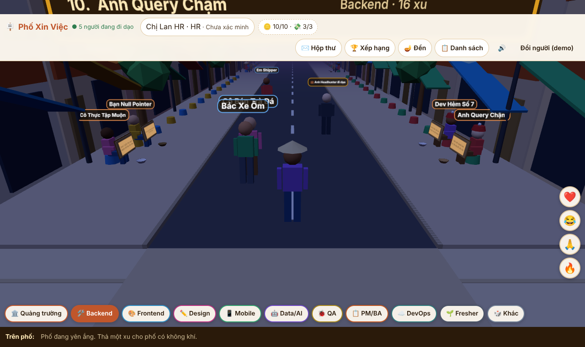
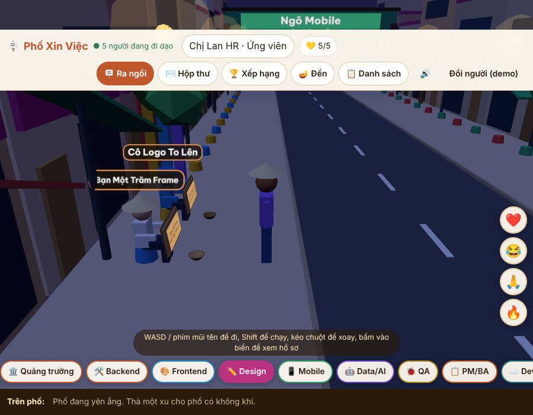
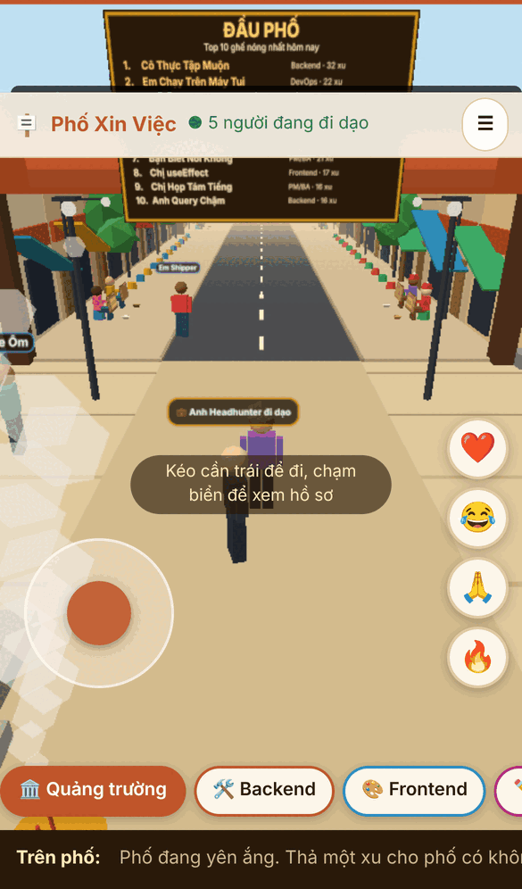
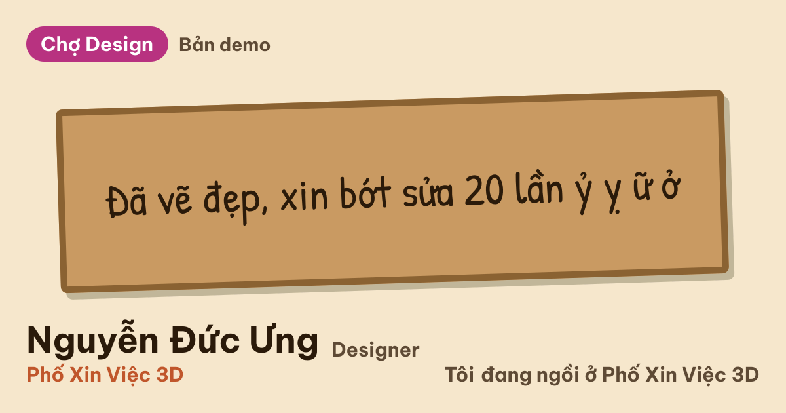

# Phố Xin Việc 3D

> Con phố nơi dân IT ngồi vỉa hè xin việc cho vui: ứng viên cầm biển carton tự trào, HR đi dạo thả xu, thả **500k**, **bao trọn**.
> Xu và 500k đều là **xu ảo**. Đây là một trò chơi, không ai xin hay trao tiền thật.

**English, short:** a humorous, multi-user 3D street where IT job candidates sit on the pavement holding self-deprecating
cardboard signs, and recruiters walk by to drop (virtual) coins, send "500k" interview invitations and make "all-in" offers.
Next.js 16 + React Three Fiber on the front, Supabase (anonymous auth, Postgres RPCs, Realtime) on the back, and a full
offline **demo mode** (localStorage + BroadcastChannel) so `pnpm dev` works with no account at all.

| Phố ban ngày | Phố ban đêm | Trên điện thoại | Thẻ chia sẻ (OG) |
|---|---|---|---|
|  |  |  |  |

Ảnh chụp bằng Chromium với WebGL phần mềm (SwiftShader), nên khung hình trông thô hơn trên máy thật.

## Tính năng

- **Phố 3D**: 10 khu nghề (Backend, Frontend, Design, Mobile, Data/AI, QA, PM/BA, DevOps, Fresher, Khác), mỗi khu 30 ghế, ghế đẹp
  theo điểm xếp hạng (xu của HR có trọng số lớn, hao dần theo thời gian, "ngồi lì" được cộng điểm). Đi bằng WASD hoặc cần điều khiển
  trên điện thoại, chạm biển để mở CV. Ngày/đêm theo giờ máy, đèn lồng sáng về chiều.
- **Nhiều người cùng đi dạo**: thấy người khác di chuyển, thả cảm xúc (tim, cười, chắp tay...), đếm người đang online.
- **Luồng tuyển dụng đầy đủ**: thả xu (HR, 2 xu/ứng viên/ngày) -> **thả 500k** (lời nhắn + liên hệ, mở khóa liên hệ ứng viên)
  -> ứng viên nhận lời -> **bao trọn** (vị trí, gói) -> chấp nhận -> hồ sơ chuyển sang **Đã được bao**, có thông báo và ticker.
- **Ứng viên**: biển tự trào (có mẫu gợi ý), CV công khai tối thiểu, liên hệ chỉ mở cho HR đã thả 500k, ẩn khỏi ticker, ẩn/xóa hồ sơ.
- **Đền và quẻ**: thắp nhang mỗi ngày, xin quẻ cố định theo người và ngày, chia sẻ thẻ quẻ.
- **Chia sẻ**: `/c/<slug>` có ảnh OG động (tiếng Việt đủ dấu), nút chia sẻ, tải ảnh, Zalo/Facebook.
- **An toàn nội dung**: bộ lọc từ cấm (chuẩn hóa Unicode, leet, ký tự ẩn), chặn thông tin cá nhân trên biển/bio, báo cáo (3 người báo cáo
  thì biển tự ẩn chờ duyệt), trang quản trị `/api/admin/moderate`.
- **Hai chế độ backend**: Supabase thật hoặc demo cục bộ, cùng một interface `Backend`.
- **Trợ năng**: danh sách 2D thay cho 3D, hộp thoại bẫy phím Tab và đóng bằng Esc, nhãn cho nút biểu tượng, `prefers-reduced-motion`.

## Chạy thử nhanh (demo mode, không cần backend)

```bash
pnpm install
pnpm dev            # http://localhost:3000
```

Không đặt biến môi trường Supabase thì app chạy ở chế độ demo: "database" nằm trong localStorage, các tab trình duyệt nói chuyện qua
BroadcastChannel, mỗi tab là một người dùng khác nhau. Mở **hai tab** và thử luồng đầy đủ:

1. Tab A: vào phố bằng vai **HR** (nhập tên công ty).
2. Tab B: vào phố bằng vai **Ứng viên**, bấm "Ra ngồi", điền biển và lưu.
3. Tab A: chọn khu của ứng viên, mở CV, bấm "Thả xu". Tab B nhận toast và nghe "leng keng".
4. Tab A: "Thả 500k". Tab B: Hộp thư, "Nhận lời". Tab A: "Bao trọn". Tab B: "Chấp nhận" và hồ sơ thành **Đã được bao**.

Mẹo: `?view=2d|3d` ép kiểu hiển thị, `?t=day|night` ép ngày/đêm, `?debug=1` hiện fps/draw calls, `?as=<tên>` ép id demo cố định,
nút "Đổi người (demo)" biến tab hiện tại thành người dùng khác. Có vài bot HR và vài người đi dạo giả (tắt bằng `NEXT_PUBLIC_DEMO_BOTS=0`).

## Scripts

| Lệnh | Mô tả |
|---|---|
| `pnpm dev` / `pnpm build` / `pnpm start` | Next.js dev, build production, chạy production |
| `pnpm typecheck` | `tsc --noEmit` |
| `pnpm lint` | ESLint (có luật cấm `dangerouslySetInnerHTML`) |
| `pnpm test` | Vitest: luật, kiểm duyệt, xếp hạng, DemoBackend, SupabaseBackend (client giả), parity SQL/TS |
| `pnpm test:db` | Chạy migration + bộ test SQL trên một PostgreSQL tạm (cần binary Postgres 15+, không cần Docker) |
| `pnpm test:e2e` | Playwright (Chromium có sẵn, không chạy `playwright install`): luồng demo 2 tab, 3D smoke, chia sẻ/OG, trợ năng |

`pnpm test:e2e` tự `pnpm build && pnpm start` ở cổng 3100 ở chế độ demo. Dùng lại build có sẵn: `E2E_SKIP_BUILD=1`; trỏ tới server khác: `E2E_BASE_URL=...`.
Sinh lại `supabase/seed.sql` từ `src/lib/seed.ts`: `GEN_SEED=1 pnpm vitest run tests/parity/seed-sql.test.ts`.

## Kiến trúc

```
Trình duyệt
  React 19 UI (DOM panels)  <-- zustand stores -->  R3F scene (instanced, ~45 draw calls)
            \                                          /
             Backend interface  (src/backend/types.ts)
              |                                   |
        DemoBackend                         SupabaseBackend
   localStorage + Web Locks             anonymous auth + RPC (security definer)
   BroadcastChannel (events, poses)     private Realtime channels
Server (Next.js): /c/[slug] + OG images (public RPC, anon key), /api/admin/moderate (service role)
```

- **Một interface, hai backend** ([ADR-0001](.squad/adr/0001-backend-adapter-and-demo-mode.md)): `src/backend/index.ts` chọn Supabase khi có
  `NEXT_PUBLIC_SUPABASE_URL` + `NEXT_PUBLIC_SUPABASE_ANON_KEY` (trừ khi `NEXT_PUBLIC_FORCE_DEMO=1`). Luật nghiệp vụ nằm trong thủ tục SQL và
  bản sao TypeScript của chúng (`src/backend/demo/engine.ts`), có test parity.
- **Supabase** ([ADR-0002](.squad/adr/0002-supabase-realtime-approach.md)): mọi thao tác ghi là RPC `security definer` (không client nào ghi bảng trực tiếp),
  sự kiện phố và thông báo được **phát từ database** qua `realtime.send` lên kênh riêng `street` và `inbox:<uid>` (client không thể giả mạo),
  vị trí đi dạo là broadcast của client trên kênh `pos:<khu>` (chỉ khu hiện tại và khu bên cạnh), số người online là presence trên `street`.
  Tin nhắn bị lỡ khi mất mạng không được phát lại: client tự tải lại danh sách khi nối lại, thông báo offline lấy từ bảng `notifications`.
- **3D** ([ADR-0003](.squad/adr/0003-procedural-low-poly-instead-of-gltf.md)): hình khối low-poly dựng bằng code (không glTF), `InstancedMesh` cho ứng viên/người đi dạo,
  chữ vẽ bằng canvas texture, `PerformanceMonitor` hạ DPR khi tụt FPS, texture/geometry được dispose khi unmount, nhãn tên tự tránh chồng nhau theo không gian màn hình.
- **Xếp hạng** ([ADR-0004](.squad/adr/0004-ranking-formula-and-seat-assignment.md)): điểm hao dần theo nửa đời 7 ngày, chia ghế cố định cho mỗi khu.

## Cài đặt Supabase

1. Tạo project Supabase. Cài [Supabase CLI](https://supabase.com/docs/guides/cli), `supabase login`, `supabase link --project-ref <ref>`.
2. Kiểm tra locale database là `C.UTF-8` hoặc `en_US.UTF-8` (migration tự dừng nếu là `C`, vì bộ lọc tiếng Việt sẽ vô hiệu).
3. `supabase db push --dry-run` rồi `supabase db push` (đúng một migration: `0001_init`). Muốn có sẵn các ứng viên "Mẫu": chạy `supabase/seed.sql` trong SQL editor
   (hoặc `supabase db reset` khi làm local, đã khai báo trong `supabase/config.toml`).
4. Dashboard, Authentication, Providers: **bật Anonymous sign-ins** (giữ giới hạn rate theo IP, cân nhắc Turnstile CAPTCHA).
5. Dashboard, Realtime, Settings: chỉ cho phép kênh private. Không expose schema `private` ở Settings, API.
6. Điền biến môi trường (bảng bên dưới), build và chạy.

Migration đã được chạy thật trên PostgreSQL 16 với 54 nhóm kiểm tra (`pnpm test:db`). Phần **không thể kiểm chứng cục bộ** (Realtime authorization thật, `realtime.send`,
`x-forwarded-for`, JWT ẩn danh) và **danh sách việc cần làm ở lần deploy đầu tiên** (kiểm tra bằng 2 trình duyệt, đọc log `ErrorSendingBroadcastMessage`...)
nằm trong [`.squad/DB-VERIFICATION.md`](.squad/DB-VERIFICATION.md). Đọc nó trước khi deploy. Không bao giờ sửa `0001_init.sql` sau khi đã push, thay đổi mới nằm trong `0002_*.sql`.

Quay về demo bất cứ lúc nào bằng cách bỏ hai biến `NEXT_PUBLIC_SUPABASE_*` (hoặc đặt `NEXT_PUBLIC_FORCE_DEMO=1`) và build lại.
Nếu Supabase không với tới được, app hiện banner "Mất kết nối", vẫn cho xem trang chia sẻ (ứng viên mẫu) và tự thử nối lại sau mỗi 10 giây.

## Deploy lên Vercel

1. Import repo vào Vercel (framework Next.js, `pnpm` được nhận từ `packageManager`). Không cần cấu hình build đặc biệt.
2. Thêm biến môi trường (Production và Preview) như bảng dưới, **kể cả `NEXT_PUBLIC_SITE_URL`** là domain thật để link OG tuyệt đối.
3. Các biến `NEXT_PUBLIC_*` được nhúng lúc build: đổi chúng thì phải build lại.
4. CSP được đặt theo từng request trong `src/proxy.ts` (nonce + `'strict-dynamic'`, `base-uri 'none'`, `form-action 'self'`, `object-src 'none'`; HSTS và COOP nằm trong `next.config.ts`) và chỉ cho phép `connect-src` tới đúng host Supabase đã cấu hình (https và wss), không dùng wildcard.
5. Sau deploy: làm theo checklist smoke test trong `.squad/DB-VERIFICATION.md` mục 6, và thử `/c/mau-backend-1` (ảnh OG phải ra PNG).

## Biến môi trường

| Biến | Nơi dùng | Mô tả |
|---|---|---|
| `NEXT_PUBLIC_SUPABASE_URL`, `NEXT_PUBLIC_SUPABASE_ANON_KEY` | client + server | Bật SupabaseBackend. Thiếu một trong hai thì chạy demo. Chỉ anon key được ra trình duyệt. |
| `NEXT_PUBLIC_FORCE_DEMO` | client + server | `1` ép demo dù đã có biến Supabase. |
| `NEXT_PUBLIC_SITE_URL` | server | Domain gốc cho link OG tuyệt đối (mặc định `http://localhost:3000`). |
| `NEXT_PUBLIC_DEMO_BOTS` | client | `0` tắt bot demo (mặc định bật). |
| `SUPABASE_SERVICE_ROLE_KEY` | **chỉ server** | Cho `/api/admin/moderate`. Không bao giờ để tiền tố `NEXT_PUBLIC_`. |
| `ADMIN_KEY` | **chỉ server** | Khóa cho header `x-admin-key` của `/api/admin/moderate` (so sánh thời gian hằng). **Phải dài >= 32 ký tự**, ngắn hơn thì route trả 503. Sai khóa 5 lần/IP thì bị chặn tạm (429); mọi thao tác admin được ghi log JSON (`scope: admin_audit`). Tạo khóa: `openssl rand -hex 32`. |
| `SHARE_SECRET` | **chỉ server** | Khóa HMAC ký tên người chơi trong link chia sẻ quẻ `/q/<id>?n=&d=&s=` (>= 16 ký tự, nên `openssl rand -hex 32`). Thiếu thì tên bị bỏ và thẻ hiện "Một người qua đường", để không ai nhét chữ tùy ý lên domain của phố. |
| `NEXT_PUBLIC_TURNSTILE_SITE_KEY` | client | Bật CAPTCHA Cloudflare Turnstile ở màn đăng ký (chỉ Supabase mode). Token được gửi cùng `signInAnonymously`. Xem mục CAPTCHA bên dưới. |
| `NEXT_PUBLIC_REPORT_EMAIL` | client | Địa chỉ nhận "Báo cáo HR này" (mailto). Bỏ trống thì nút chỉ hướng dẫn cách báo cáo. |

### CAPTCHA chống tài khoản ảo (Turnstile)

1. Tạo widget ở Cloudflare Turnstile (Managed), lấy **Site key** và **Secret key**.
2. Supabase Dashboard > Authentication > Settings (Attack Protection) > bật **Enable Captcha protection**, chọn **Cloudflare Turnstile**, dán Secret key.
3. Đặt `NEXT_PUBLIC_TURNSTILE_SITE_KEY=<site key>` rồi build lại. Khi biến này có, CSP tự thêm `https://challenges.cloudflare.com` vào `script-src`/`frame-src` (chỉ lúc đó); onboarding hiện widget và đăng nhập ẩn danh chỉ chạy sau khi giải xong. Demo mode không bị ảnh hưởng.
4. Bật bước 2 mà quên bước 3 thì mọi lần đăng nhập ẩn danh sẽ bị Supabase từ chối. Làm cả hai cùng lúc.

### Giới hạn tần suất (rate limiting)

`/api/og/*`, `/api/share/sign` và `/api/admin/*` có token bucket theo IP **trong bộ nhớ** (`src/server/rateLimit.ts`). Đó chỉ là lớp làm chậm kiểu best effort: mỗi lambda của Vercel có bộ nhớ riêng. Khi lên production hãy đặt thêm luật Vercel WAF / Cloudflare Rate Limiting cho `/api/og/*` và `/api/admin/*`. `GET /api/street` (snapshot phố, cache 15 giây) và `getPublicCandidate` (cache 60 giây) giảm tải RPC cho trang chia sẻ.

Kiểm duyệt thủ công (khi biển bị báo cáo và chờ duyệt):

```bash
curl -H "x-admin-key: $ADMIN_KEY" https://<domain>/api/admin/moderate                      # danh sách chờ duyệt
curl -X POST -H "x-admin-key: $ADMIN_KEY" -H "content-type: application/json" \
  -d '{"candidateId":"<uuid>","action":"approve_sign"}' https://<domain>/api/admin/moderate  # approve_sign | remove_sign | hide | delete
```

## Giọng điệu và an toàn

- Tự trào, tử tế, không công kích cá nhân hay tổ chức. UI luôn nói rõ **xu ảo / trò chơi**; không có nút donate hay thanh toán. Từ 16 tuổi ([`/terms`](src/app/terms/page.tsx)).
- Liên hệ của ứng viên không bao giờ nằm trong dữ liệu công khai: chỉ chủ hồ sơ và HR đã gửi lời mời mới đọc được qua RPC (giới hạn 3 lời mời/ngày chống cào).
- Không dùng `dangerouslySetInnerHTML`; chữ người dùng chỉ ra DOM dạng text node, trong 3D ra canvas `fillText`, trong ảnh OG ra JSX của satori.
- Giới hạn chống lạm dụng (xu, 500k, báo cáo, tạo hồ sơ, IP) nằm trong RPC với khóa advisory, không tin client.
- Vị trí đi dạo chỉ mang tính trang trí, không có máy chủ game nên không được xác thực phía server (người nhận kẹp trong biên phố).

## Cấu trúc thư mục

```
src/
  app/                 Next.js routes: /, /c/[slug], /q/[id], /terms, /api/og/*, /api/admin/moderate
  backend/             Backend interface, demo/ (localStorage + bus), supabase/ (client, mappers, presence)
  components/          app/ (StreetApp), ui/ (panels, HUD), scene/ (R3F)
  lib/                 logic thuần: luật, kiểm duyệt, xếp hạng, ghế, quẻ, mã hóa chia sẻ, declutter...
  scene-lib/           hình học procedural, texture, ánh sáng, nhận diện thiết bị
  server/              dữ liệu công khai cho /c và OG, phông OG, helper admin
  state/ hooks/ audio/ zustand stores, hooks đồng bộ, âm thanh
  assets/fonts/        TTF cho OG (OFL)        public/fonts/  woff2 cho canvas
supabase/              migrations/0001_init.sql, seed.sql, config.toml, tests/ (test SQL)
tests/                 Vitest (lib, backend, parity)        e2e/  Playwright
docs/screenshots/      ảnh trong README
.squad/                yêu cầu, thiết kế, ADR, ghi chú dev, báo cáo kiểm chứng DB
```

## Ghi công và giấy phép

- Phông **Patrick Hand** (chữ biển) và **Be Vietnam Pro** (nhãn 3D, ảnh OG) theo giấy phép SIL Open Font License 1.1: xem
  `src/assets/fonts/OFL-PatrickHand.txt` và `src/assets/fonts/OFL-BeVietnamPro.txt`.
- Dựng trên Next.js, React, three.js, React Three Fiber, drei, zustand, Supabase (đều MIT hoặc tương đương).
- Toàn bộ ứng viên "Mẫu" và HR bot là hư cấu. Mô hình 3D, âm thanh và biển được tạo bằng code, không dùng asset bên thứ ba.
- Repo chưa có file `LICENSE`: hãy thêm một giấy phép trước khi công khai nếu muốn cho phép tái sử dụng.
